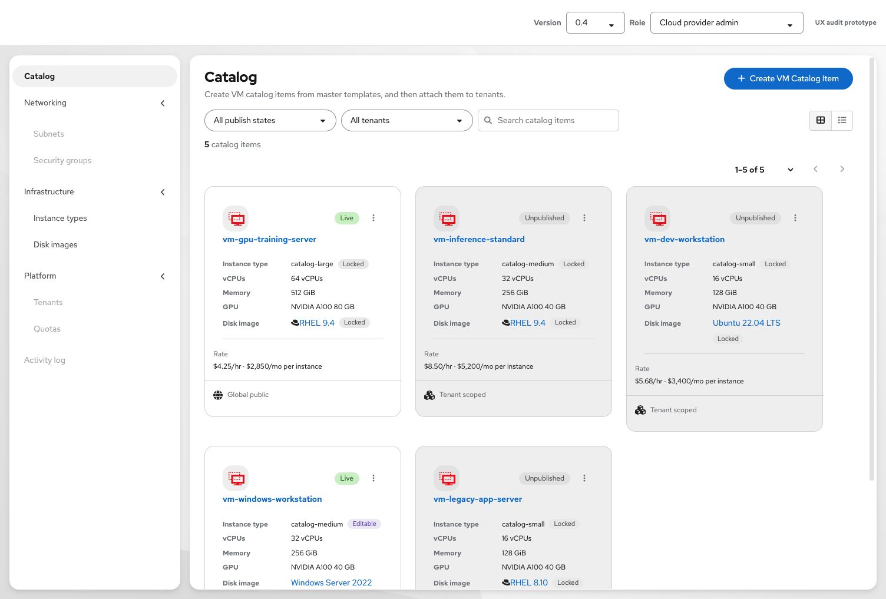
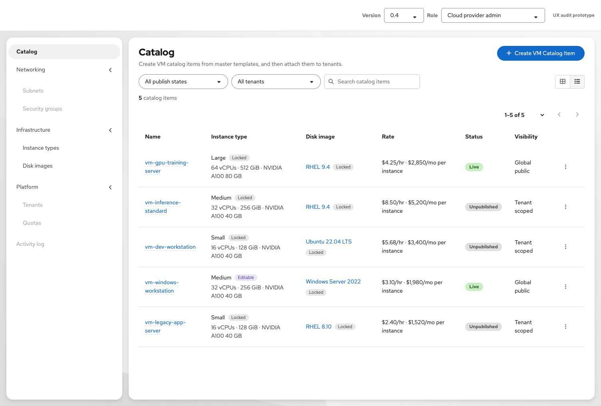
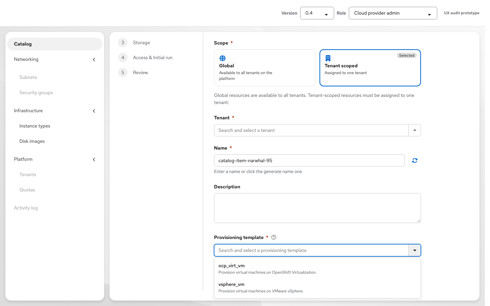
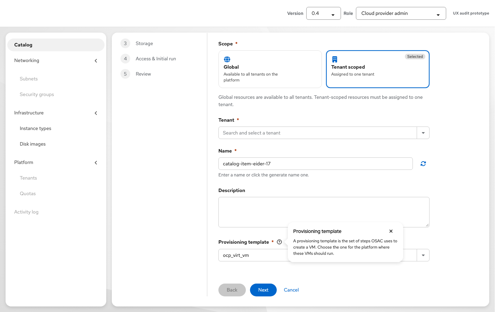
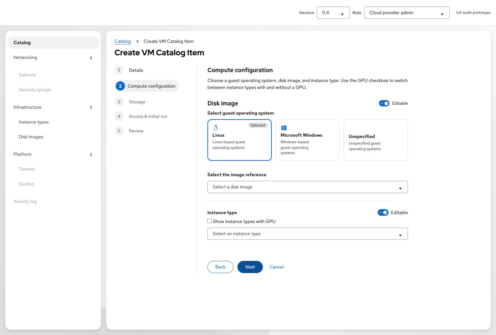
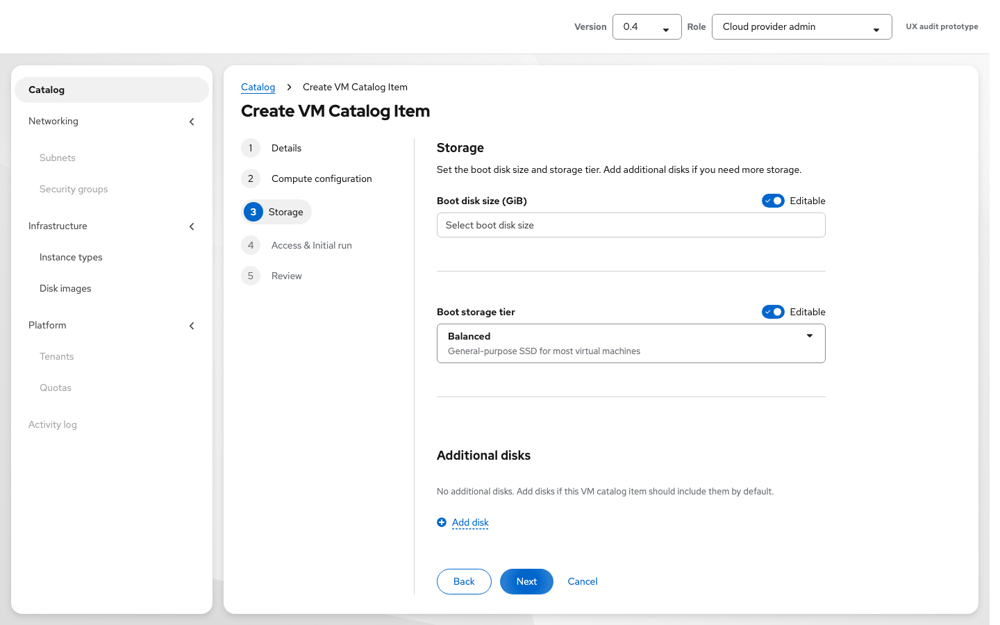
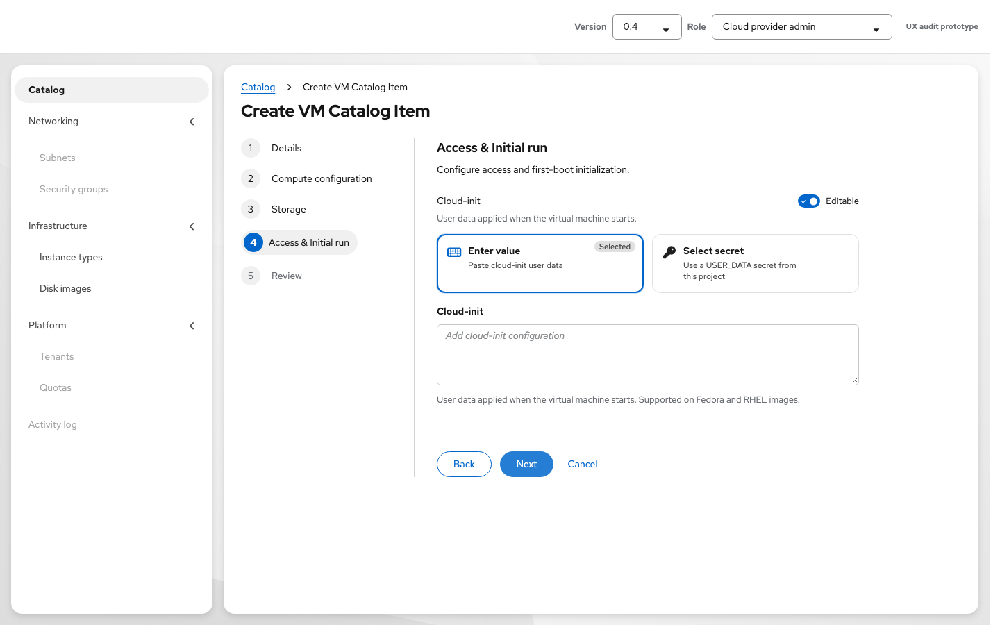

# Catalog items — UX handoff

Contact: Yifat Friman Menchik, UXD  
Jira: [HPUX-2175](https://redhat.atlassian.net/browse/HPUX-2175)  
Google Doc: [Catalog items](https://docs.google.com/document/d/1YTm2X4nUXWVI_Mjq_hXEY4Rj6i9BaOiXjzVeF3jcMA4/edit)  
Interactive mock: [Catalog, Cloud provider admin](https://osac-project.github.io/osac-ux/vmaas-ux-prototype-v0.4.html?v=38d7305&role=provider)

This handoff describes the **0.4** mockup. Version **0.5** is available for subsequent work.

In **0.5**, Catalog cards group vCPUs, memory, and GPU beneath **Instance type** with an indented vertical rule, matching the BMaaS card hierarchy. The GPU row says **None** when the selected instance type has no GPU; a dash remains reserved for unavailable data.

The provider Catalog list supports publish-state and tenant filters, search, and card and table views. Both views show compact PatternFly pagination above the list: an item-range dropdown with Previous and Next. Show a second pagination control below the list only when results span multiple pages. The item count reflects the selected project or other active scope.

On each Catalog card, show the **Instance type** name with its own Editable or Locked badge, followed by vCPUs, memory, and GPU as supporting specs. Show the **Disk image** with its separate badge. The badges describe whether tenants can change that specific value during VM creation; their tooltip and accessible label explain the effect. This follows the field-level pattern in Ethan's card design. Other editable settings remain on the catalog item details page rather than adding every field to the compact card.

The table view shows the same two badges. Its Instance type cell puts the name and badge first, with CPU, memory, and GPU details underneath. In the wizard, each Editable/Locked control keeps a short visible label; its accessible name states the field, current setting, and effect.

The Create VM Catalog Item wizard runs **Details → Compute configuration → Storage → Access & Initial run → Review**. Details sets scope, name, description, and provisioning template. A provisioning template option shows its name above its description. The selected template name or ID appears in Review and catalog item details. The help popover says: “A provisioning template is the set of steps OSAC uses to create a VM. Choose the one for the platform where these VMs should run.”

Compute configuration sets guest OS, disk image, and instance type. Instance type options show the **resource name first** and the CPU, memory, and any GPU count and readable model in a second-line description, followed by the rate. For example: **small-gpu** / `1 vCPU · 2 GiB memory · 1 GPU (NVIDIA A100 40 GB) · $1.90/hr`. Do not show PCI device IDs in this menu. Keep Deprecated selectable and labeled; omit Obsolete from new choices. Existing Obsolete values remain visible until replaced.

Long instance type names wrap to two lines above their resource description. If a name still does not fit, truncate it and reveal the full name on hover or keyboard focus. Keep the full name available to screen readers, including in the Instance types list.

The same lifecycle distinction applies to disk images in the catalog item wizard: keep Deprecated options selectable and labeled; omit Obsolete images from new choices.
Show the explanation beside the **Deprecated** label on hover or option focus, rather than on the whole option.

In Storage, Boot storage tier has no separate **Clear selection** action or **No default** option. Users can select another tier; a Locked tier requires a selection.

The Access & Initial run introduction is “Configure access and first-boot initialization.” for Linux, and “Configure first-boot customization.” for Windows.

The provider can edit an instance type from its details page. Edit opens on **Configuration**, with vCPUs, memory, and GPU fields visible immediately; General remains available for scope, description, and labels. The name stays read-only.

For field governance, storage, initial-run data, publication, and details behavior, follow the [Google UX handoff](https://docs.google.com/document/d/1YTm2X4nUXWVI_Mjq_hXEY4Rj6i9BaOiXjzVeF3jcMA4/edit).
