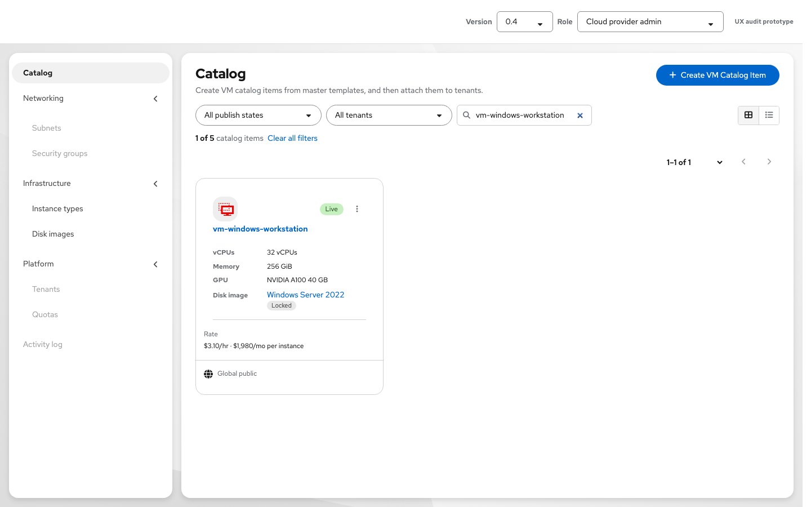
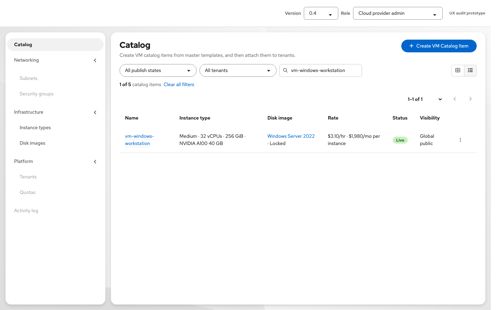

# Compact pagination in mockup lists

Contact: Yifat Friman Menchik, UXD  
Interactive mock: [VMaaS 0.4 mockup](https://osac-project.github.io/osac-ux/vmaas-ux-prototype-v0.4.html?v=0.4&role=admin)

The **Virtual machines**, **Virtual networks**, **Catalog items**, **Instance types**, and **Disk images** lists use compact PatternFly pagination: a visible item range and total in a dropdown, followed by Previous and Next. The dropdown changes items per page (10, 20, 50, or 100). Previous and Next are disabled at the corresponding boundary. Filtering resets to the first page. Card and table views share the same page state. For **Catalog items**, show the bottom control only when results span multiple pages; keep the top control in both views.

