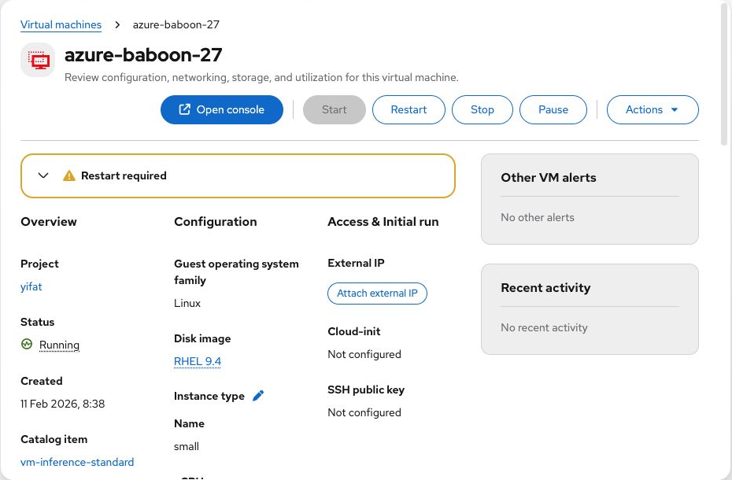
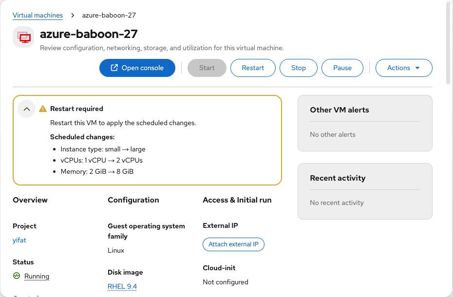
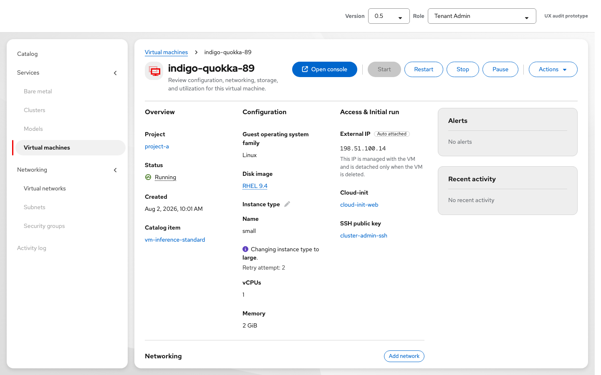
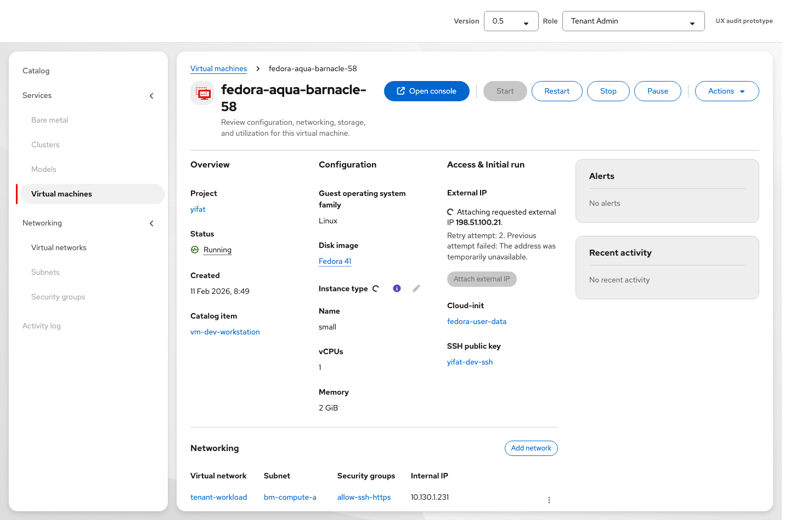
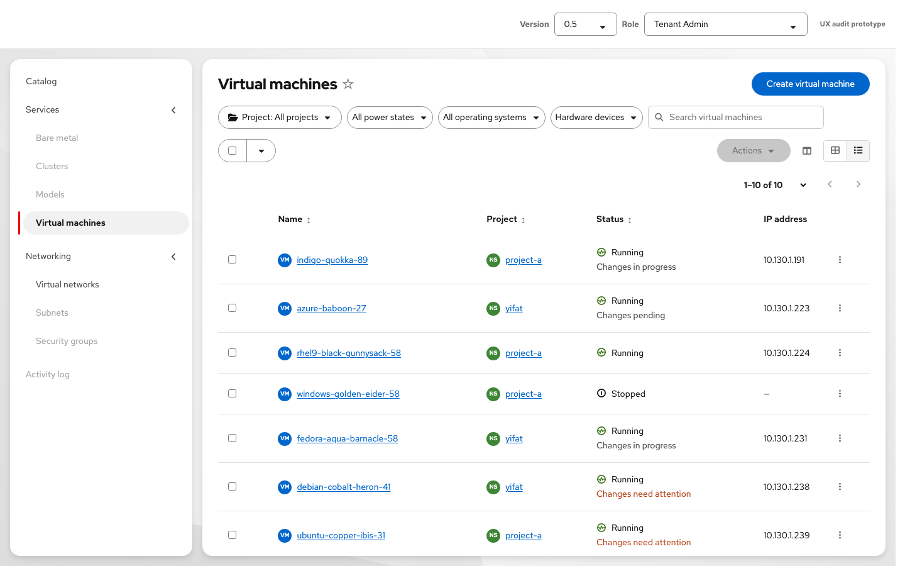
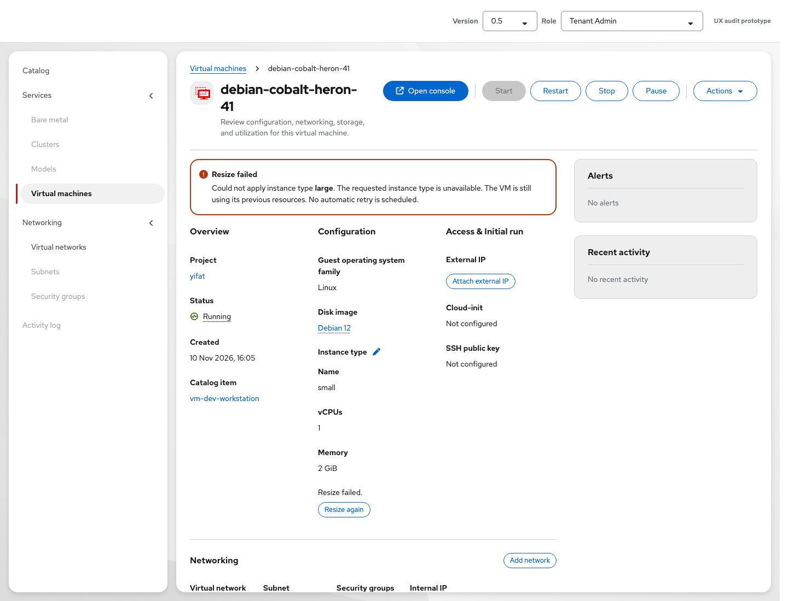
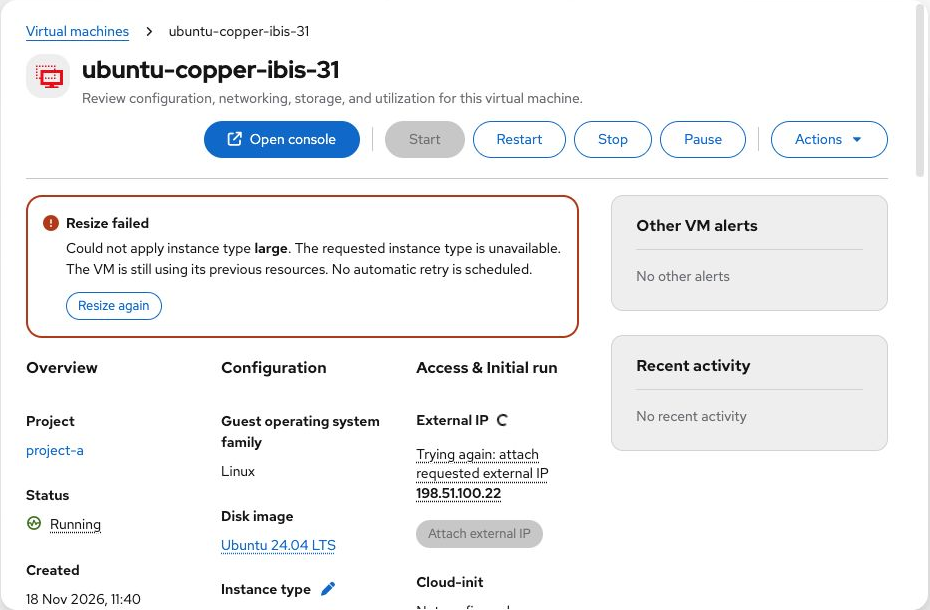

# VM resize via instance type

Contact: Yifat Friman Menchik, UXD  
Updated: 12 November 2026

UX Google Doc: https://docs.google.com/document/d/1kgln_LzTA3-VSP0SUM0jLce2Nvw0pix3oTYkwZuX-wE/edit  
Interactive mockup, 0.4: https://osac-project.github.io/osac-ux/vmaas-ux-prototype-v0.4.html?v=0.4&role=admin&vm=windows-golden-eider-58

Interactive mockup, 0.5: https://osac-project.github.io/osac-ux/vmaas-ux-prototype.html?v=983960c&role=admin&vm=fedora-aqua-barnacle-58
Feature: [OSAC-4277](https://redhat.atlassian.net/browse/OSAC-4277)  
Resize: [OSAC-4281](https://redhat.atlassian.net/browse/OSAC-4281)  
Related work: [OSAC-7576](https://redhat.atlassian.net/browse/OSAC-7576), [OSAC-7463](https://redhat.atlassian.net/browse/OSAC-7463), [OSAC-7582](https://redhat.atlassian.net/browse/OSAC-7582), [OSAC-6578](https://redhat.atlassian.net/browse/OSAC-6578)

## Entry and availability

On VM Overview, select the pencil beside Instance type. Tenant Admin and Tenant User can resize. The action is available for Running, Paused, and Stopped VMs, and unavailable during transitional states, while a resize is scheduled or applying, or while a failed resize is being resolved.

## Select an instance type

The modal has a required typeahead Instance type field and Save/Cancel actions. Each option shows the instance type name on the first line and CPU, memory, GPU count and readable model, and rate in the description below. For example: **small-gpu** followed by `1 vCPU · 2 GiB memory · 1 GPU (NVIDIA A100 40 GB) · $1.90/hr`. Omit PCI IDs from the visible description; use the GPU count, resource name, and PCI selector for compatibility filtering. The VM's GPU configuration cannot change during resize. Do not predict hot-plug or restart from boot-disk access mode before submission. Show submit failures inside the modal.

Allow long instance type names to wrap to two lines, with the resource details still below the name. If the name needs more than two lines, truncate it and reveal the full name on hover and keyboard focus. The full name and resource details remain in the option's accessible name. The mockup includes `instance-type-e2e-resize-cpu-up-memory-down` as an example in both the Instance types list and selection menus.

Show Deprecated instance types as selectable options with a **Deprecated** label and tooltip: “Still available, but being phased out. We recommend an active type.” Omit Obsolete types from the menu. If the VM currently uses an Obsolete type, show it as the current value in the resize form and require the user to choose a different type before saving. Keep the lifecycle label visible after selecting a Deprecated type. The same rule applies in Create VM and Create VM Catalog Item; see [instance type lifecycle selection](instance-type-lifecycle-selection.md).

## After Save

A success toast confirms the saved request. For a Running or Paused VM that requires restart, show a **Restart required** warning at the top of VM Overview in version 0.5. It is collapsed by default; expanding it explains that the VM must restart and shows the current → requested instance type, vCPUs, and memory. Do not repeat the restart message beside Instance type. Keep the VM's **active** instance type, vCPUs, and memory as the main configuration values, including the CPU and memory totals in Utilization. The 0.4 screenshots below retain the earlier layout for historical comparison.

On the VM list, retain the normal power status (for example, Running). In 0.5, show one subdued gray, text-only **Changes pending** status on a second line in the Status column while restart is required; its tooltip names the resize target and explains that a restart is needed. Cards use the same placement below the power status. A Stopped VM's new size applies on its next start. The 0.4 screenshots below show the earlier **Resize scheduled** label beside the name.

## Resize in progress

When the API reports that a resize is applying without a restart, keep **Running** as the VM power state. In 0.5, show one subdued gray, text-only **Changes in progress** status on a second line below the power status in card and table views; its tooltip names the resize target and any other active configuration operation. VM Overview shows progress beside Instance type, including the requested type and any known retry attempt. Keep active values until the API confirms completion. The mockup uses `indigo-quokka-89` for this state.

After a restart with a scheduled resize, remove **Restart required** and show **Changes in progress** in lists while the resize is applying, even if the power state has returned to **Running**. In version 0.5, details show the operation beside Instance type. The mockup uses `fedora-aqua-barnacle-58` for this state; restarting `azure-baboon-27` also demonstrates the transition.

Do not show a persistent top progress notification, timing details, or a Recent activity entry for this brief operation. Keep the instance type name, CPU, memory, and GPU together; show progress after those specs. Remove the configuration status only when the API confirms completion, then show the new instance type, CPU, and memory as active values and a brief success toast. Keep configuration progress separate from the VM power state, as required by OSAC-6578. These states require operation phase and active versus requested values from the API; the mockup timer only demonstrates completion and must not be used as production logic. If resize fails, keep current resources visible, show **Changes need attention** in the 0.5 list, put the reason in a top danger alert, and show only a short **Resize failed** cue with **Resize again** beside Instance type. If known, say **No automatic retry is scheduled** in the alert; the user can still submit a new resize. `ubuntu-copper-ibis-31` demonstrates a failed resize while external-IP attachment continues.

The API must expose or allow derivation of both active and requested configuration values, the restart-required condition, the resize operation phase, and a failure reason. Backend acceptance of the update depends on OSAC-5328.

## Current mockup screenshots

**Instance type choices.** The resource name is the primary line and the configuration is the description. This same pattern applies to Create VM and Create VM Catalog Item.

**List pagination.** VM card and table views use the compact PatternFly count dropdown with Previous and Next controls.

**Instance type lifecycle.** Deprecated remains selectable and labeled; Obsolete is omitted from the menu.

**Version 0.5 collapsed restart warning.** The title remains visible near the top until the VM restarts.

**Version 0.5 expanded restart warning.** The requested values are available on demand.

**Version 0.4 collapsed restart notice.** Earlier design for comparison.

**Restart required.** The active values remain visible until restart.

**Resize applying without restart.** A compact label appears beside the VM status.

**Progress tooltip.** The requested instance type and phase are visible on focus or hover.

**Resize still applying after restart.** The same label has a phase-specific tooltip.

**VM table.** This 0.4 screenshot shows the older resize-specific labels. In 0.5, the Status column uses one text-only configuration status below the power status per VM.

**Resize failure.** Current resources stay visible; the reason appears in a danger notification.

## Provisioning failure (separate state)

When provisioning fails, show **Failed to provision** in the VM list and overview instead of leaving the VM at Starting. Show the failure reason. Do not invent Stop, Cancel, or Retry actions; add a recovery action only after the backend supports a safe transition. Track this separately in [OSAC-7582](https://redhat.atlassian.net/browse/OSAC-7582).
