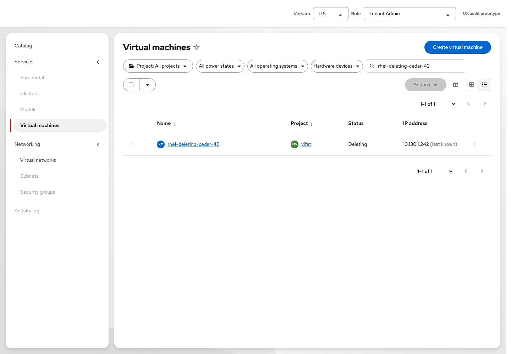
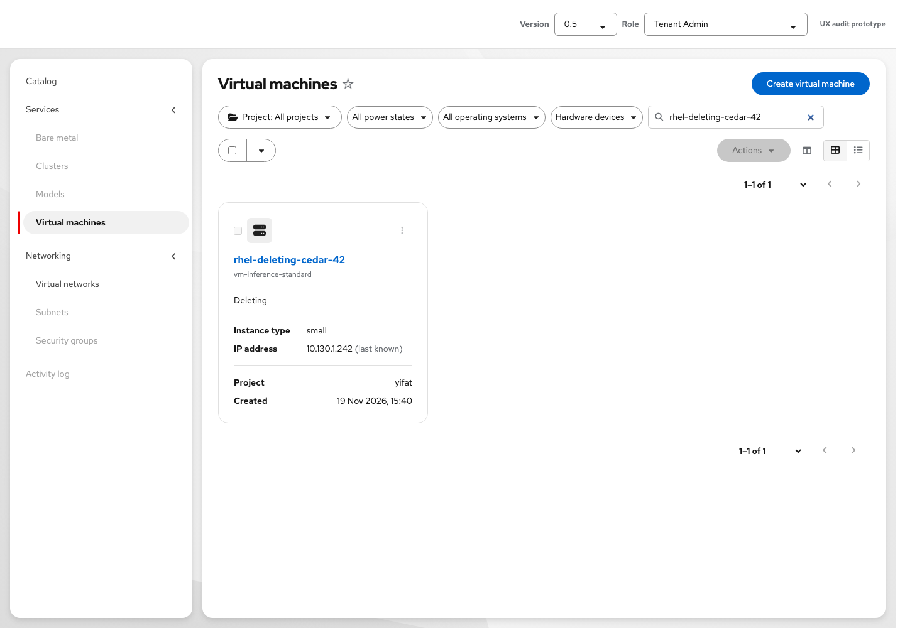
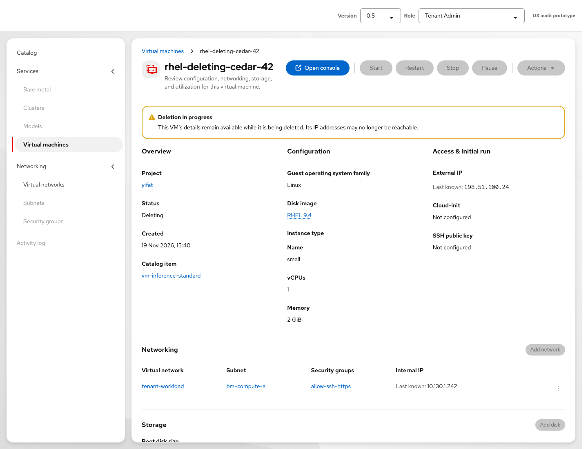

# VM details during deletion — OSAC-7100

Contact: Yifat Friman Menchik, UXD

| Reference | Link |
| --- | --- |
| Jira | [OSAC-7100](https://redhat.atlassian.net/browse/OSAC-7100) |
| Parent feature | [OSAC-7096](https://redhat.atlassian.net/browse/OSAC-7096) |
| Google UX doc | [VM details during deletion](https://docs.google.com/document/d/1QIHeiWFlrTZdyJolrKHZ-lTPVM0Htaes4q26PhwGMSc/edit) |
| Interactive mock | [Version 0.5 deleting VM](https://osac-project.github.io/osac-ux/vmaas-ux-prototype.html?v=f7f6cb2&role=admin&vm=rhel-deleting-cedar-42) |

This handoff covers the VM deletion state in version 0.5. OSAC-7096 also covers CaaS clusters; those screens are not represented in this VM mockup.

## List and card

Keep the VM name linked to its details while the resource still exists. Show **Deleting** as the state, identify the displayed IP as **last known**, and make row selection and actions unavailable during deletion. The name link remains active in both views.

## Details

Keep identity and available configuration visible. Show **Deleting** in the Status field, aligned with the other Overview values. Place this information alert above Overview:

> **Deletion in progress**  
> This VM’s details remain available while it is being deleted. Its IP addresses may no longer be reachable.

Mark external and internal IP values **Last known**. Make console, power, configuration, networking, storage, and delete actions unavailable. Read-only links to related resources can remain accessible.

## Completion and failure

Once deletion is confirmed, remove the VM from the list and return any open details page to that list. Do not keep a deleted-resource page. If deletion fails while the VM still exists, keep details accessible and show a safe, readable reason. Do not expose provider job IDs, logs, or raw errors, or offer unsupported cancel/retry controls. The 0.5 mockup illustrates deletion in progress; a failed-deletion screen is not yet illustrated.

The UI needs an authoritative deletion state and confirmation that the resource is gone. Acceptance of a delete request alone must not remove the details page.
