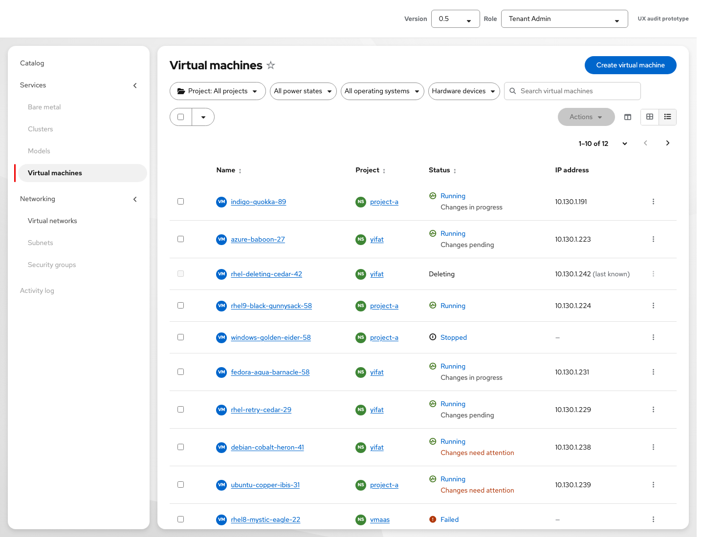
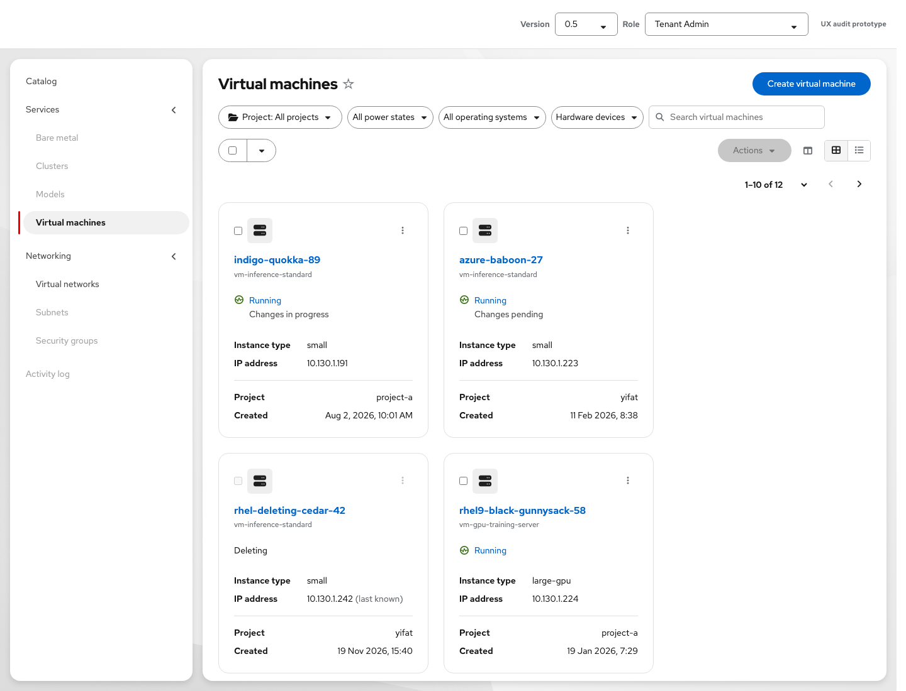
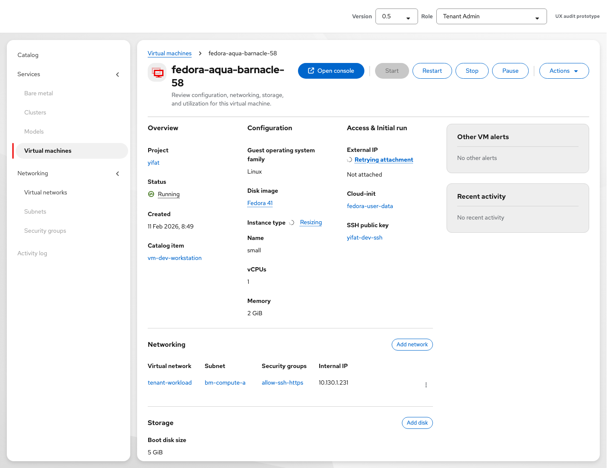
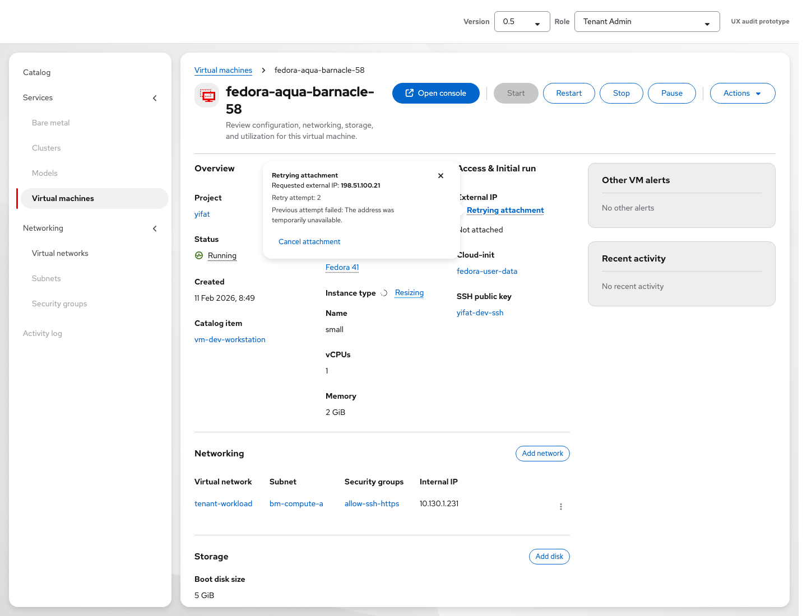
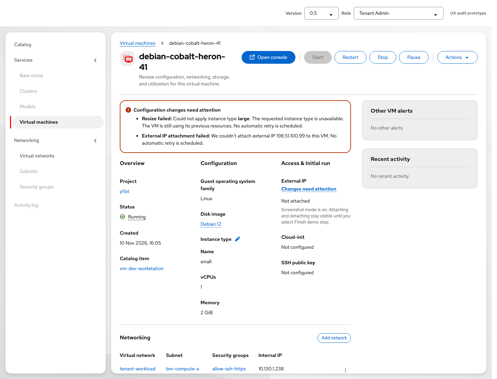
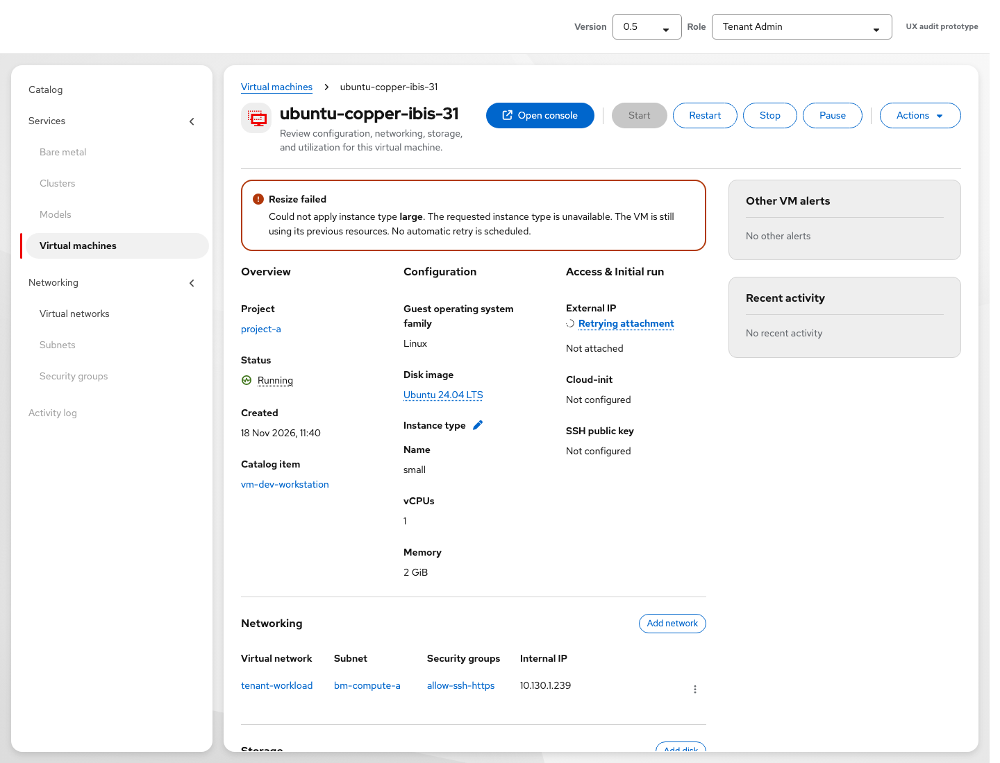
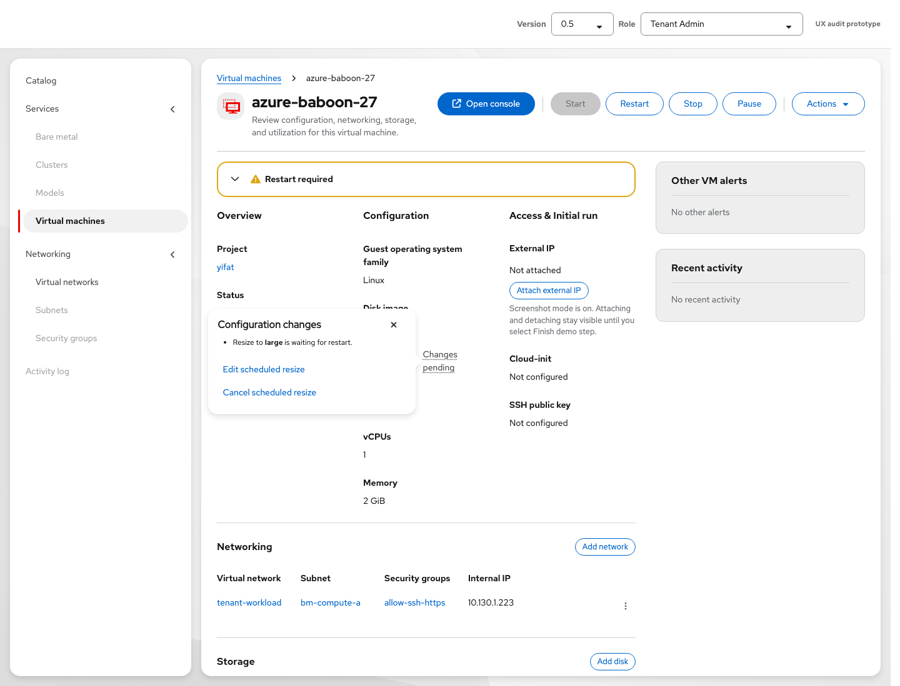
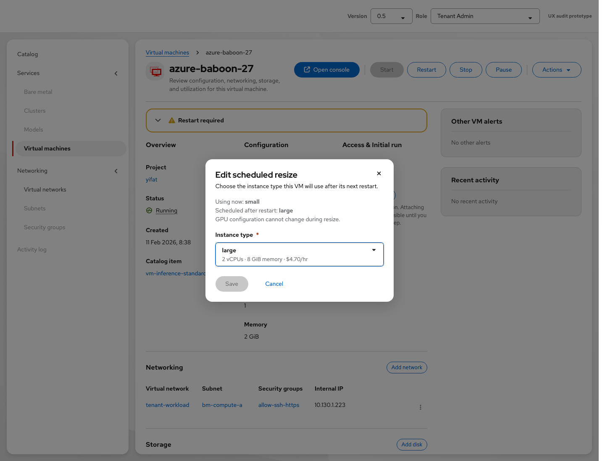

# VM configuration operations

[OSAC-7158](https://redhat.atlassian.net/browse/OSAC-7158) version 0.5

Contact: [Yifat Friman Menchik](mailto:yfrimanm@redhat.com), UXD

| Jira | [OSAC-7158](https://redhat.atlassian.net/browse/OSAC-7158) |
| --- | --- |
| Parent feature | [OSAC-6578](https://redhat.atlassian.net/browse/OSAC-6578) |
| Scope | Resize, external IP attach/detach, retries, failures, and restart |
| Role | Tenant User, Tenant admin; actions follow permissions |
| Interactive mock | [Version 0.5](https://osac-project.github.io/osac-ux/vmaas-ux-prototype.html?role=admin) |
| MD handoff | [Configuration operations](https://github.com/osac-project/osac-ux/blob/main/docs/osac-7158-configuration-operations.md) |

This handoff covers visibility and recovery for VM configuration operations. Current values remain visible until a change succeeds. Power status stays separate from configuration work.

## UX behavior

### Lists and cards

Use clickable PatternFly power statuses, including **Failed** rather than Error. Align the configuration subtext beneath the status text, not its icon. Use the same treatment in table and card views.

- **Changes pending**, gray: waiting for restart or a backend-confirmed automatic retry.
- **Changes in progress**, gray: an attempt is running, including an automatic retry.
- **Changes need attention**, red: a final failure requires user recovery.

When multiple operations coexist, final failure takes precedence over in-progress work, which takes precedence over pending work. The popover lists every outstanding operation separately, with its target, state, and any supplied retry details. For example, a failed resize and a running attachment show **Changes need attention**, but the IP operation continues independently. An earlier failed attempt does not make an active retry red.

### VM details and actions

Keep the active instance type, vCPUs, memory, and attached IP visible. Show **Not attached** without the prefix “Current external IP” when no address is attached. During detachment, retain the address until success.

Use PatternFly’s static **In progress** icon beside the heading with a link-styled popover trigger: **Resizing**, **Attaching**, or **Detaching**. During external-IP retries use **Retrying attachment** or **Retrying detachment**. Waiting for an automatic retry uses **Changes pending** without an active icon. Remove the disabled resize pencil while work is running. Do not leave disabled Attach/Detach buttons beside the setting.

The popover shows the requested instance type, vCPUs, and memory, or the exact external IP. Include **Retry attempt: [number]** and **Previous attempt failed: [reason]** only when supplied. Do not infer a retry schedule from an attempt count or invent an ETA.

Keep **Cancel attachment** in the attachment popover. After final attachment failure, the popover offers **Retry attachment** for users with permission. The instance-type pencil opens a new resize request after final resize failure. Automatic retries cannot be stopped; disable competing requests while the service owns the retry. Cancellation requests the previous spec and finishes only after backend confirmation. If attachment wins the race, show the attached address and supported Detach action; failed cancellation preserves the operation and shows an error.

Only final failures appear in one top danger alert, with a bullet per failed operation. Keep actions out of that alert; use page controls and operation popovers. Automatic retries do not produce a top alert. Users without attachment permission receive guidance to ask a tenant administrator.

### Scheduled resize and restart

Keep a collapsed **Restart required** warning above Overview. Expanding it shows the changed instance type, CPU, and memory values. This actionable restart warning is separate from automatic retries.

For a resize waiting for restart, replace the pencil with **Changes pending**. Its popover contains **Edit scheduled resize** and **Cancel scheduled resize**. The edit dialog shows **Using now** and **Scheduled after restart**; **Save** replaces the scheduled target. Cancel scheduled resize requests the currently active spec. Keep the existing target until the service confirms success; preserve it and show an error on failure.

Restart opens a confirmation naming the VM, workload interruption, and exact changes. Focus Cancel initially. Recheck permissions, power state, and changes before submitting. Keep progress visible after restart until the requested resources are active. Success updates current values, clears completed operations, and shows a success toast; no persistent Completed line.

Dialogs contain keyboard focus. Escape closes the picker before the dialog. Popovers support keyboard activation, Escape, and focus restoration. Returning to the list refreshes VM state while preserving view, filters, page, and valid selections. Close stale popovers. The sidebar uses **Other VM alerts** and **No other alerts** to avoid contradicting configuration failures.

## Screenshots

Table status alignment and configuration summaries.

Card status alignment using the same hierarchy.

Concurrent resize and external-IP retry, with current values visible.

Retry details and Cancel attachment inside the popover.

Final failures share one alert without action buttons.

A failed resize and a continuing IP attachment retain independent states.

Scheduled resize actions are in the Changes pending popover.

Edit the scheduled target while reviewing the active type.

## Open implementation point

The API must provide each operation’s type, target, phase, safe failure reason, and available attempt data. Confirm the conditions that distinguish waiting, running, automatic retry, and final failure. List and Details must remain consistent after refresh. AAP-backed changes need at least the changed field name. Full operation history is outside OSAC-7158.
