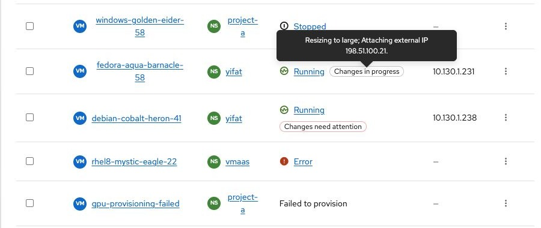
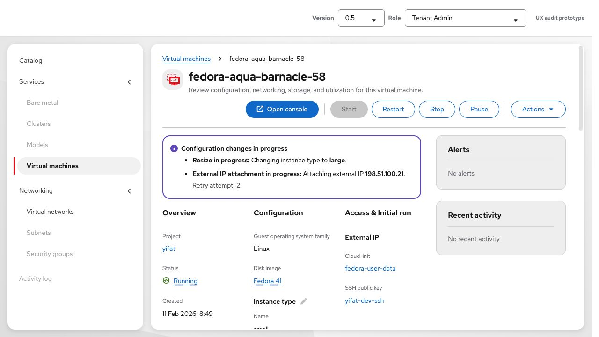
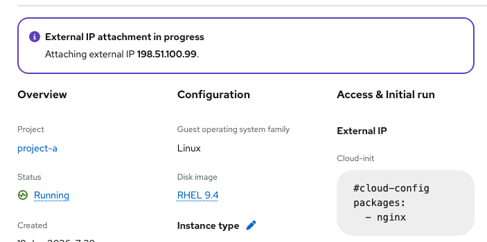
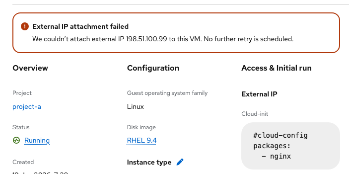
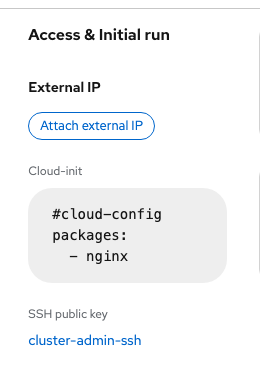
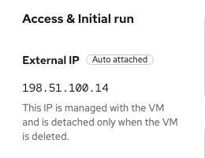
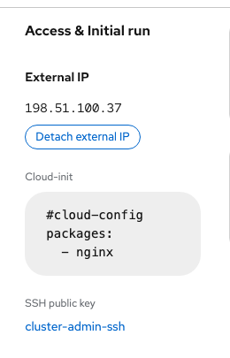
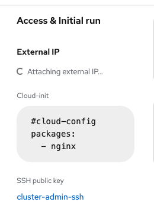

# Tenant Networking — UX handoff

Contact: Yifat Friman Menchik, UXD  
Google Doc: [Tenant Networking](https://docs.google.com/document/d/1Bb-TzaXkhdASe6btymwRk2u0wXycwyqS-I8h637hDGY/edit)  
Interactive mocks: [0.4](https://osac-project.github.io/osac-ux/vmaas-ux-prototype-v0.4.html?role=admin&vm=rhel9-black-gunnysack-58) · [0.5](https://osac-project.github.io/osac-ux/vmaas-ux-prototype.html?role=admin&vm=rhel9-black-gunnysack-58)

The Virtual networks list uses compact PatternFly pagination above and below the results: an item-range dropdown plus Previous and Next. The dropdown changes items per page (10, 20, 50, or 100). Filtering resets to the first page.

Follow the [Google UX handoff](https://docs.google.com/document/d/1Bb-TzaXkhdASe6btymwRk2u0wXycwyqS-I8h637hDGY/edit) for network and external IP attachment behavior, including loading and failure states.

On VM Overview, an auto-attached external IP shows **Auto attached** beside the External IP heading as a neutral, outlined PatternFly 6 felt glass status label. The address remains managed with the VM and cannot be detached separately.

The **External IP** heading is sufficient; do not add a Host label or empty placeholder below it. Show the address directly below the heading only after attachment succeeds. Detach is available only when an IP is confirmed attached.

In version **0.5** (OSAC-7158), show attachment progress or failure in a top-of-page alert above Overview instead of inline under External IP. Name the selected address, for example “Attaching external IP **198.51.100.99**” or “We couldn’t attach external IP 198.51.100.99 to this VM.” If another configuration operation is active, put both operations in one alert as separate bullets. Show “Retry attempt: 2” on a separate subdued line only when a later attempt is known; do not imply a fixed total. The failed address must not appear as an attached IP, and there is no manual Retry, Choose another, or Detach action in the failure state.

In the VM list, external-IP work contributes to the same single configuration label in the **Status** column as resize. Use **Changes in progress** while attaching or **Changes need attention** if attachment failed; the tooltip names the operation and selected address. Keep the VM power state separate.

## Version 0.5 screenshots

## Version 0.4 screenshots

In 0.4, attachment progress and failure appear inline under **External IP**. The address is shown only after attachment succeeds. The auto-attached and manually attached states retain their distinct controls.

