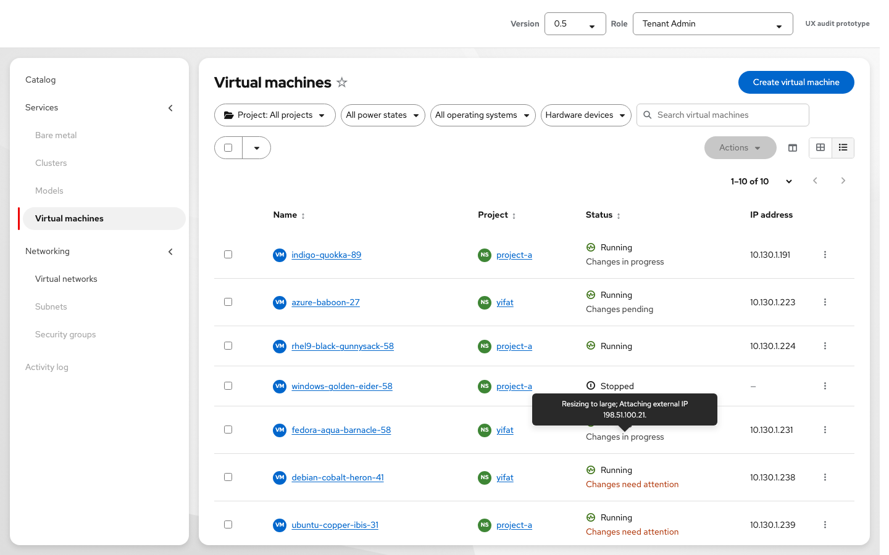
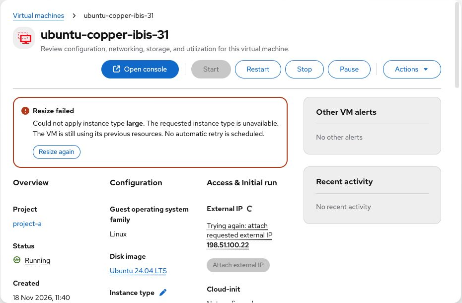
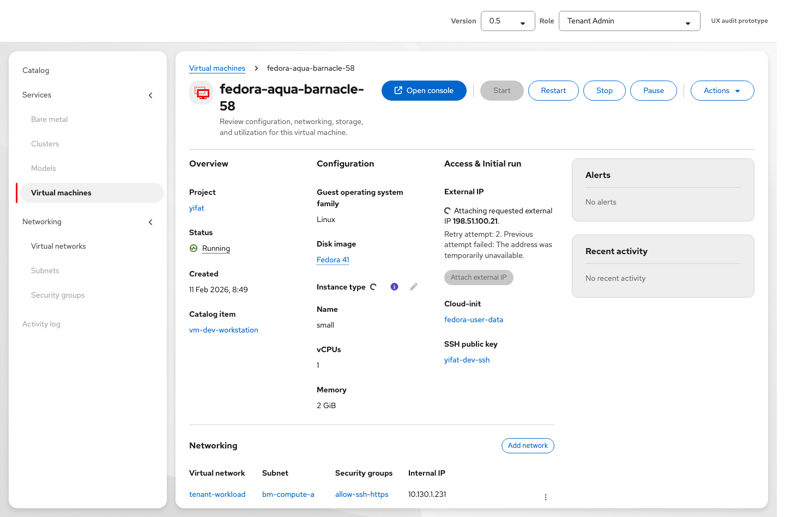
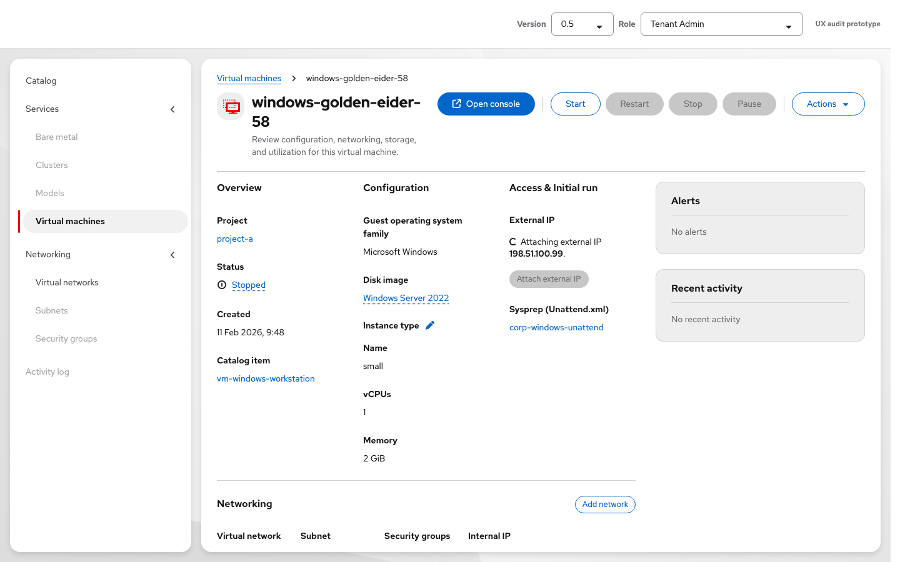
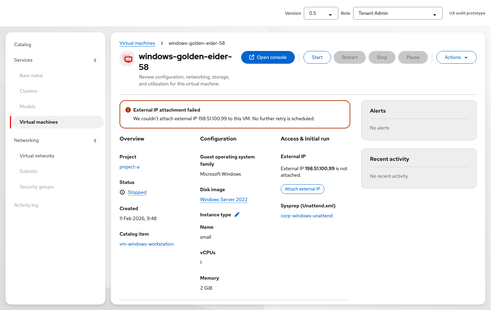
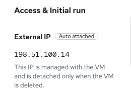
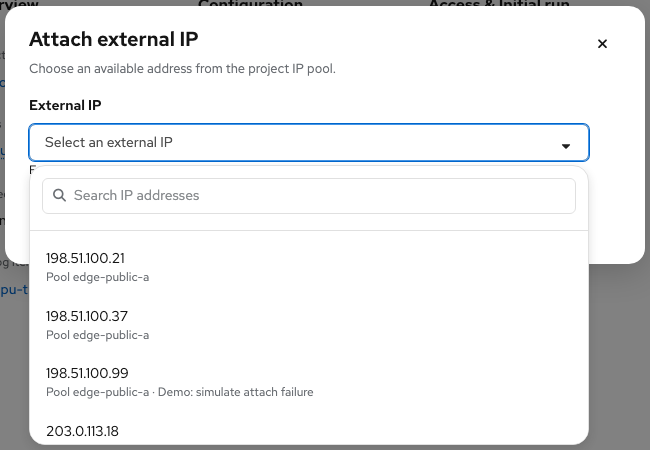
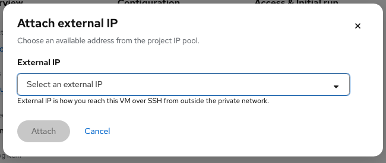
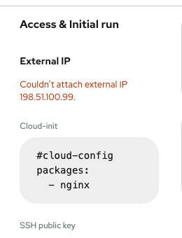

# Tenant Networking — UX handoff

Contact: Yifat Friman Menchik, UXD  
Google Doc: [Tenant Networking](https://docs.google.com/document/d/1Bb-TzaXkhdASe6btymwRk2u0wXycwyqS-I8h637hDGY/edit)  
Interactive mocks: [0.4](https://osac-project.github.io/osac-ux/vmaas-ux-prototype-v0.4.html?v=17d8bb5&role=admin&vm=rhel9-black-gunnysack-58) · [0.5](https://osac-project.github.io/osac-ux/vmaas-ux-prototype.html?v=7b7f0be&role=admin&vm=ubuntu-copper-ibis-31)

The Virtual networks list uses compact PatternFly pagination above and below the results: an item-range dropdown plus Previous and Next. The dropdown changes items per page (10, 20, 50, or 100). Filtering resets to the first page.

Follow the [Google UX handoff](https://docs.google.com/document/d/1Bb-TzaXkhdASe6btymwRk2u0wXycwyqS-I8h637hDGY/edit) for network and external IP attachment behavior, including loading and failure states.

On VM Overview, an auto-attached external IP shows **Auto attached** beside the External IP heading as a neutral, outlined PatternFly 6 felt glass status label. The address remains managed with the VM and cannot be detached separately.

The **External IP** heading is sufficient; do not add a Host label or empty placeholder below it. Show the address directly below the heading only after attachment succeeds. Detach is available only when an IP is confirmed attached.

In version **0.5** (OSAC-7158), show only the attachment status beside External IP. The status opens a popover that names the selected address, shows retry details when available, and contains **Cancel attachment** while attaching or **Retry attachment** after a final failure. Do not keep a disabled Attach button on the page. Reserve the top-of-page danger alert for failure. The failed address must not appear as an attached IP. After failure, the popover lets the user start another attachment; do not offer Detach because no address was attached.

In the VM list and cards, external-IP work contributes to one configuration status on a second line below the power status. Use subdued gray **Changes in progress** while attaching, or **Changes need attention** if attachment failed. Do not add an icon to the configuration status. The tooltip names the operation and selected address.

If resize has failed while attachment continues, the top alert describes only the resize failure, with no action buttons. The enabled Instance type edit control provides recovery, attachment progress stays beside External IP, and the list popover names both operations. See the [current configuration operations handoff and screenshots](osac-7158-configuration-operations.md). During retries use **Retrying attachment** or **Retrying detachment**, with a static PatternFly In progress icon. Show **Not attached** without a field-name prefix when no IP is attached.

## Version 0.5 screenshots

## Version 0.4 screenshots

In 0.4, attachment progress and failure appear inline under **External IP**. The address is shown only after attachment succeeds. The auto-attached and manually attached states retain their distinct controls.

