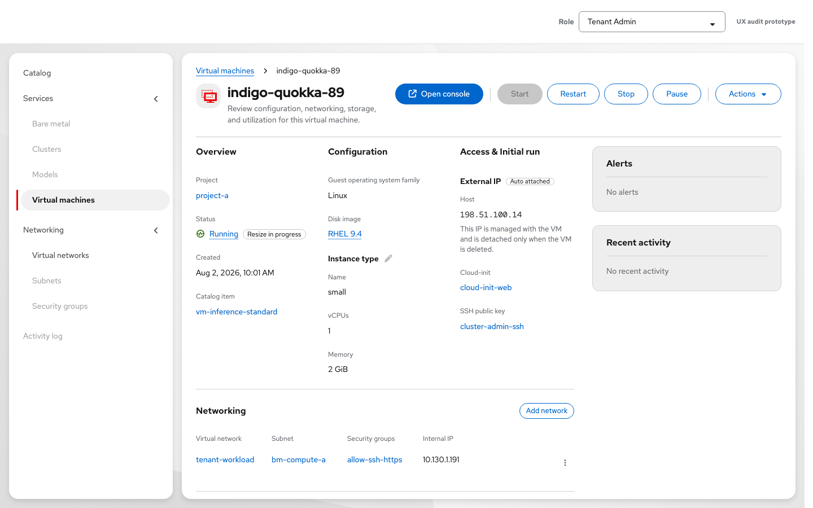
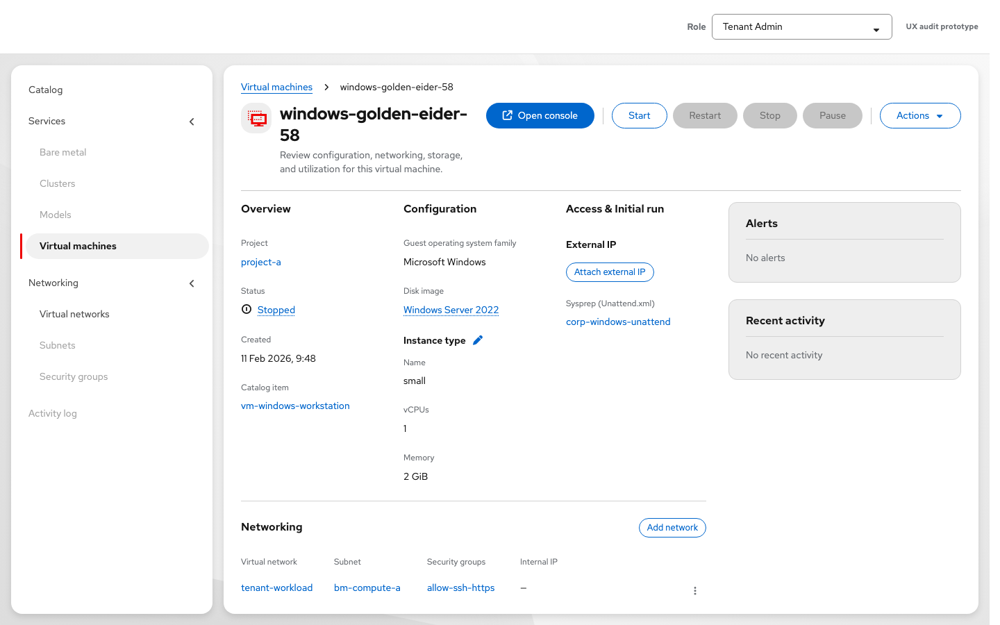
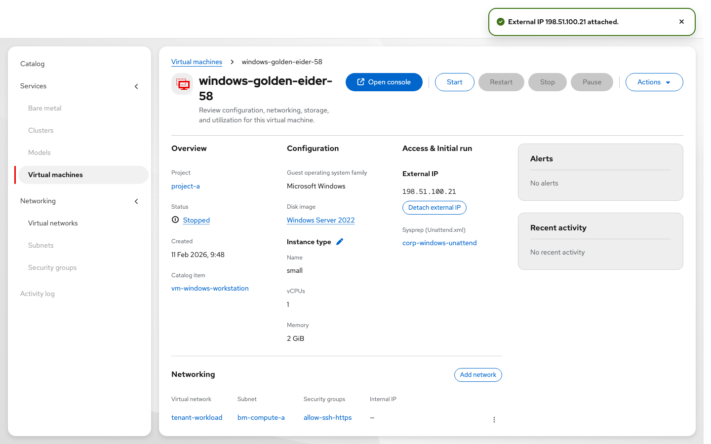
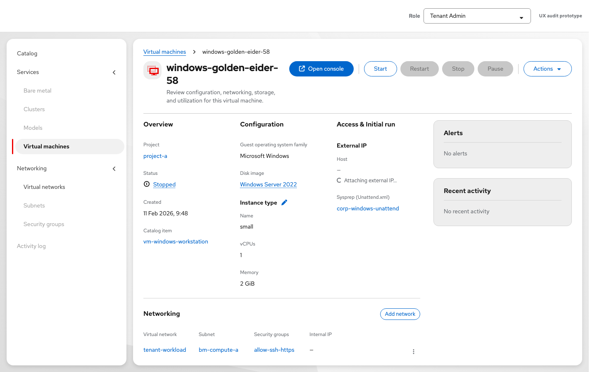

# Tenant Networking — UX handoff

Contact: Yifat Friman Menchik, UXD  
Google Doc: [Tenant Networking](https://docs.google.com/document/d/1Bb-TzaXkhdASe6btymwRk2u0wXycwyqS-I8h637hDGY/edit)  
Interactive mock: [Tenant Networking, Tenant Admin](https://osac-project.github.io/osac-ux/vmaas-ux-prototype.html?v=efa819c&role=admin&vm=indigo-quokka-89)

The Virtual networks list uses compact PatternFly pagination above and below the results: an item-range dropdown plus Previous and Next. The dropdown changes items per page (10, 20, 50, or 100). Filtering resets to the first page.

Follow the [Google UX handoff](https://docs.google.com/document/d/1Bb-TzaXkhdASe6btymwRk2u0wXycwyqS-I8h637hDGY/edit) for network and external IP attachment behavior, including loading and failure states.

On VM Overview, an auto-attached external IP shows **Auto attached** beside the External IP heading as a neutral, outlined PatternFly 6 felt glass status label. The address remains managed with the VM and cannot be detached separately.

The **External IP** heading is sufficient; do not add a Host label or empty placeholder below it. During manual attachment, show inline progress. Show the address directly below the heading only after attachment succeeds. If attachment fails, show “Couldn’t attach external IP 198.51.100.99.” (using the selected address) as an error message, without Retry, Choose another, or Detach. The failed address must not appear as an attached IP. Detach is available only when an IP is confirmed attached.

