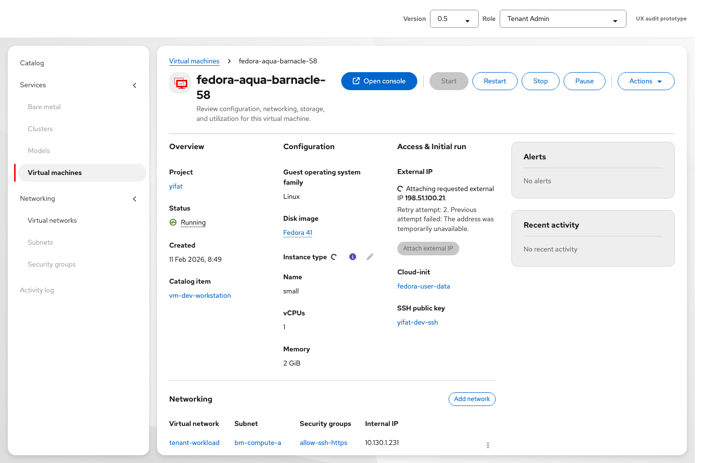
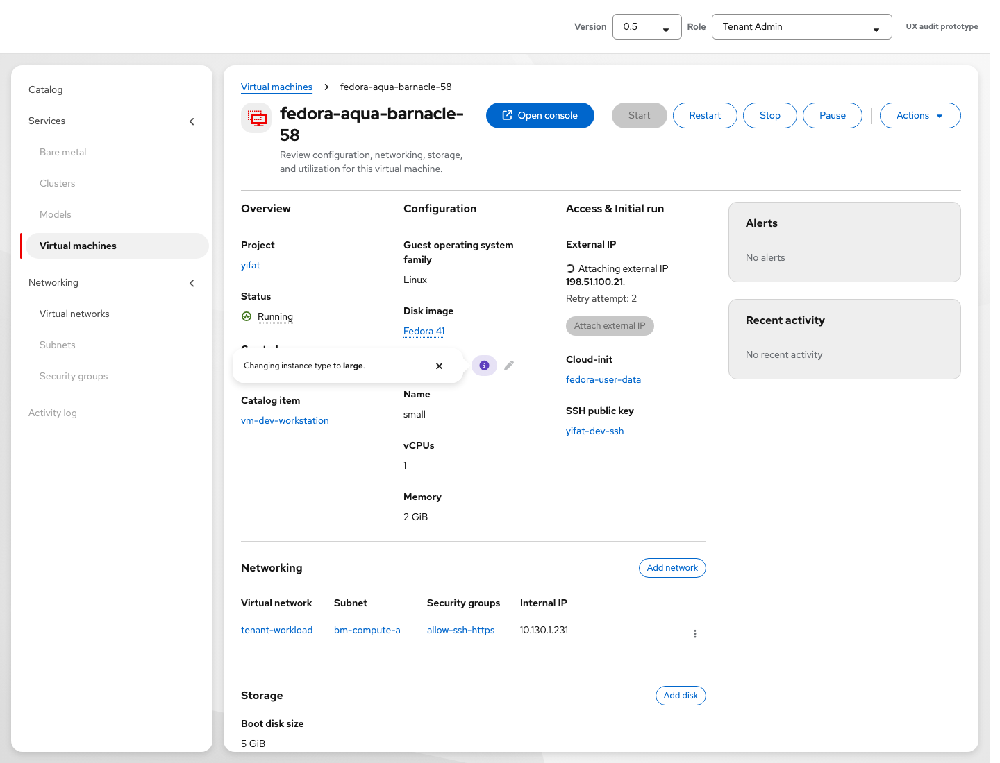
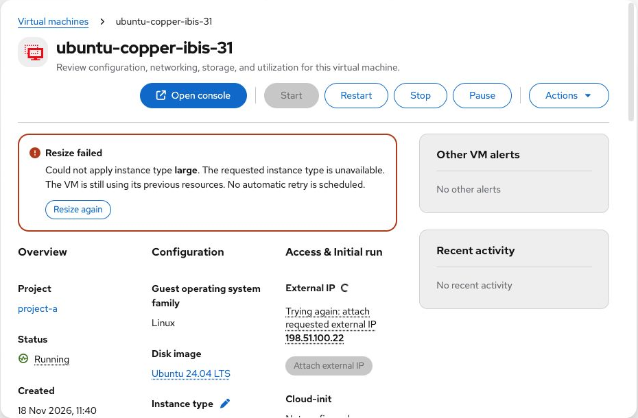
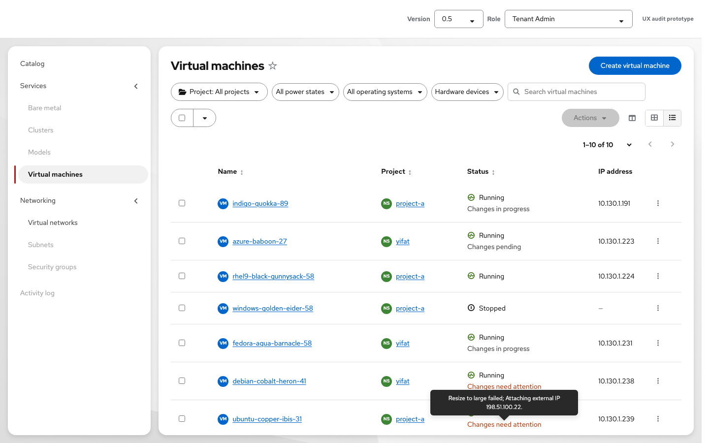
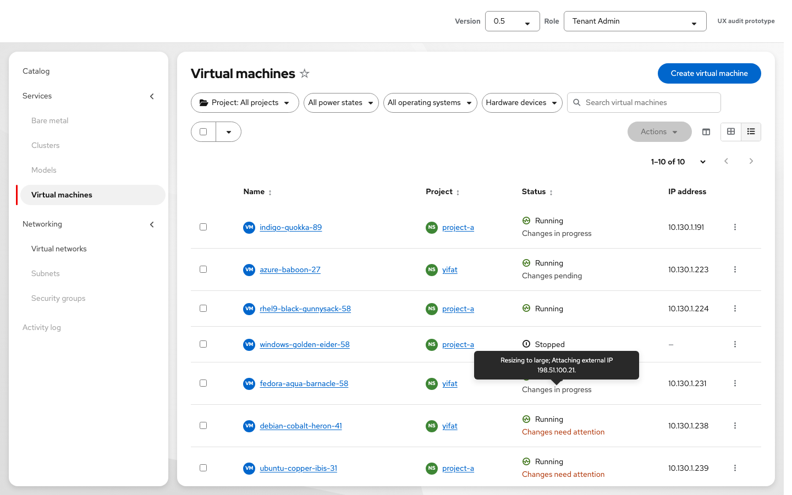
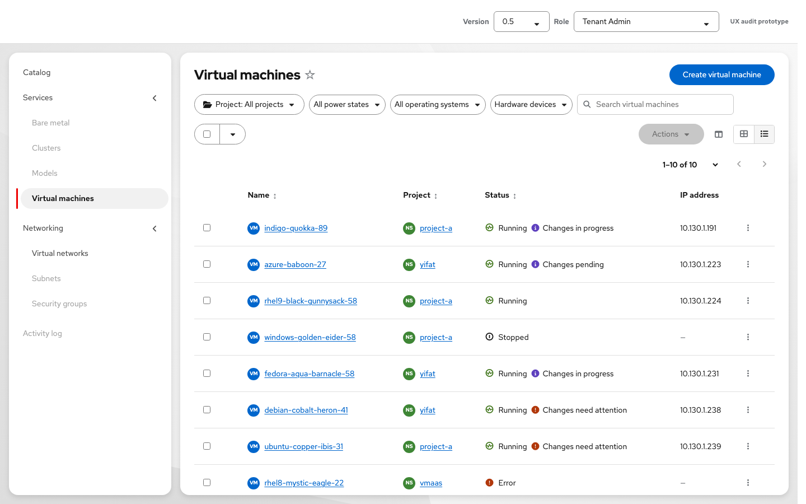
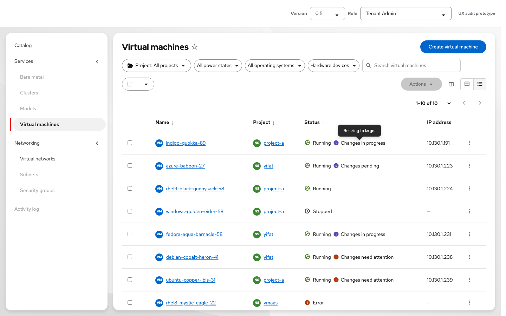
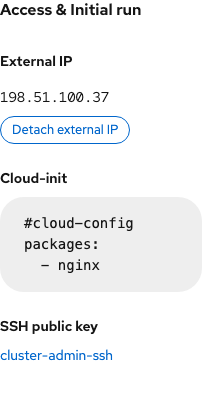
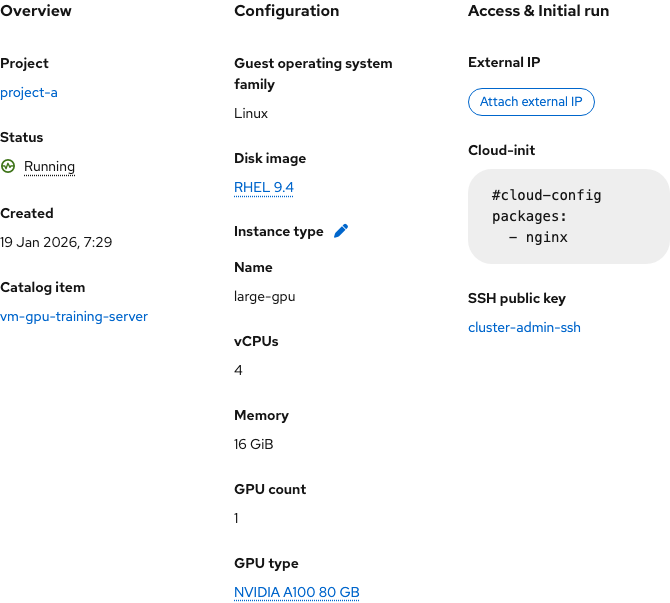

# VM Overview — UX handoff

Contact: Yifat Friman Menchik, UXD  
Google Doc: [VM Overview](https://docs.google.com/document/d/1Y8hjgE924owve0VXA3rkKqTYuB4sXKif8KhXyFL3hyQ/edit)  
Interactive mocks: [0.4](https://osac-project.github.io/osac-ux/vmaas-ux-prototype-v0.4.html?v=c6c0274&role=admin&vm=indigo-quokka-89) · [0.5](https://osac-project.github.io/osac-ux/vmaas-ux-prototype.html?v=848fccb&role=admin&vm=indigo-quokka-89)

VM Overview shows the active instance type, CPU, and memory. Editing the instance type opens the name-first, two-line picker: each option has the resource name above CPU, memory, GPU count and readable model when present, and rate. Omit PCI hardware IDs from visible labels. The GPU specification still determines which resize targets are compatible. See the [resize handoff](osac-4281-vm-resize-handoff.md).

## Version 0.5 — configuration operations (OSAC-7158)

The Overview **Status** row shows the VM power state only. Keep active instance type, CPU, memory, and attached external IP as the main values. Keep the instance type name, CPU, memory, and GPU together. While resize applies, an information icon beside the **Instance type** heading opens a keyboard-accessible popover with the target and any known retry attempt. Attachment progress remains beside External IP. The Attach external IP button remains visible but disabled while attachment runs. Use a top-of-page danger alert for failed operations; when two operations fail, list both in one alert. Put the failure reason and **Resize again** action in that alert, without repeating the failure below Instance type. Say **No automatic retry is scheduled** when that is known, so the manual action remains clear. After an attachment failure, keep the attempted address out of the attached-IP value and offer **Attach external IP** to start another selection.

The [ubuntu-copper-ibis-31 example](https://osac-project.github.io/osac-ux/vmaas-ux-prototype.html?v=848fccb&role=admin&vm=ubuntu-copper-ibis-31) combines a failed resize with external-IP attachment still running. The top alert covers the resize failure and offers **Resize again**; IP progress and its disabled Attach button stay beside External IP. In lists and cards, **Changes need attention** takes precedence, while the tooltip names both operations.

### Simultaneous changes

Each operation keeps its own state on VM Overview: resize progress is available from the Instance type icon, and external-IP attachment progress stays beside External IP. Only failures appear in the top alert. If several operations fail, use one alert with a bullet for each failure. Keep **Resize again** in the alert and offer the external-IP selection action beside External IP when available. Keep current values visible until each change succeeds.

The VM list and cards still show one configuration line below the power status. Choose its text by priority: **Changes need attention** if any operation failed; otherwise **Changes in progress** if any is running; otherwise **Changes pending** if a change waits for restart. The tooltip lists every outstanding operation and target, so the summary does not hide concurrent work. Remove each operation from the tooltip when it completes, and remove the configuration line when none remain.

If the service reports a retry, name the attempt in the tooltip and the affected setting's progress detail. If it reports a known prerequisite that blocks a change, explain the prerequisite in plain language in both places. Do not invent a blocker, attempt count, or ETA when the service has not supplied one. Keep **Stopped** as a power state, not a configuration failure. After success, update the active value, remove the outstanding status, and show a brief success toast; do not retain a Completed line.

For example, [fedora-aqua-barnacle-58](https://osac-project.github.io/osac-ux/vmaas-ux-prototype.html?v=848fccb&role=admin&vm=fedora-aqua-barnacle-58) is resizing to **large** while attaching **198.51.100.21**. Its list status is **Changes in progress**, and the tooltip names both operations. In the [mixed failure example](https://osac-project.github.io/osac-ux/vmaas-ux-prototype.html?v=848fccb&role=admin&vm=ubuntu-copper-ibis-31), resize has failed while attachment continues, so **Changes need attention** takes priority.

When a resize requires a restart, show a **Restart required** warning above Overview. It is collapsed by default; expanding it explains the required action and shows the current and requested instance type, vCPUs, and memory. Keep the current resource values in Configuration without repeating the warning there. This actionable warning is the exception to failure-only top alerts. In VM lists and cards, show one text-only configuration status on a second line below the icon-and-text power status: subdued gray **Changes pending** or **Changes in progress**, or **Changes need attention** in the failure color. Do not add an icon to the configuration status. The tooltip names each relevant operation and target, including external-IP attachment. Remove it once no work is outstanding.

In card and table views, the VM list shows one configuration status below the power status. Its tooltip lists every outstanding operation and target.

For access, networking, storage, utilization, failure states, and permissions, follow the [Google UX handoff](https://docs.google.com/document/d/1Y8hjgE924owve0VXA3rkKqTYuB4sXKif8KhXyFL3hyQ/edit).

### Implementation data needed for OSAC-7158

The UI needs the operation type, phase (waiting, applying, retrying, failed, or complete), safe explanation, target value, and timestamps from the API or from documented derivation of its existing conditions. The list and Details must describe the same state after refresh or reconnect. API list/get and CLI table/json/yaml/describe need equivalent status semantics; the HTML mockup cannot verify those contracts. Never surface provider job IDs, raw logs, or raw error strings. Elapsed time is optional and should appear only when a reliable timestamp is available.

## Access and initial run examples

These 0.5 captures show the auto-attached, manually attached, inline Cloud-init, and Windows Sysprep states.

## Storage table typography

Networking and Additional disks column headings use the standard PatternFly 6 table heading typography in both versions: 14px semibold Red Hat Text in the regular text color. The same treatment applies to other custom table headers.

