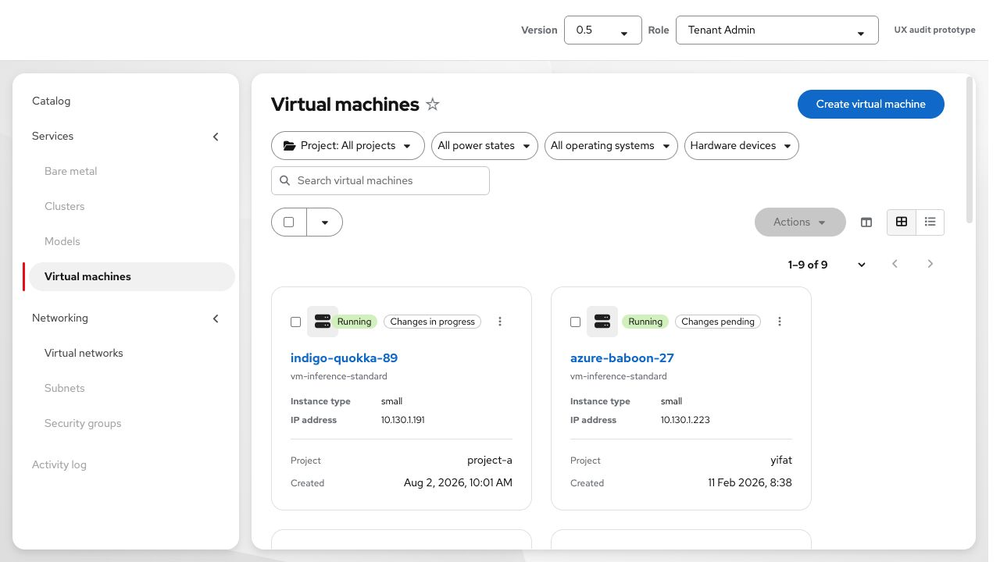
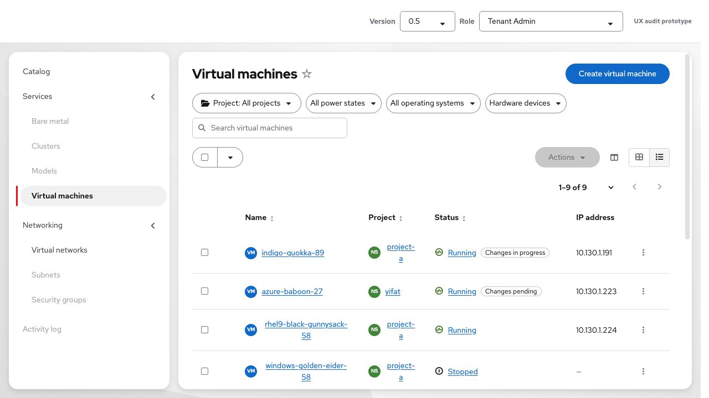
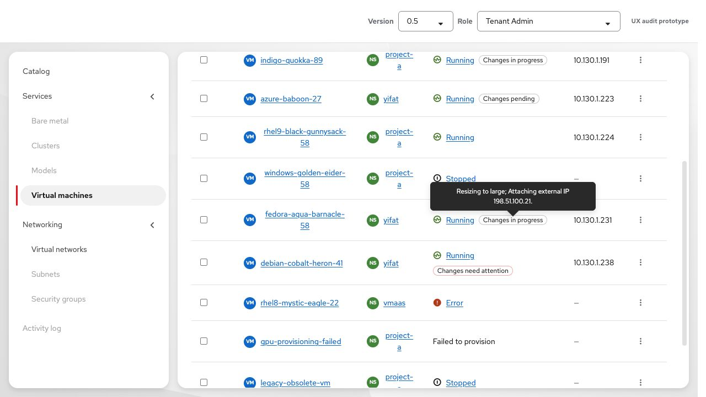

# VM Overview — UX handoff

Contact: Yifat Friman Menchik, UXD  
Google Doc: [VM Overview](https://docs.google.com/document/d/1Y8hjgE924owve0VXA3rkKqTYuB4sXKif8KhXyFL3hyQ/edit)  
Interactive mock: [VM Overview 0.5, Tenant Admin](https://osac-project.github.io/osac-ux/vmaas-ux-prototype.html?v=2c28469&role=admin&vm=fedora-aqua-barnacle-58)

VM Overview shows the active instance type, CPU, and memory. Editing the instance type opens the name-first, two-line picker: each option has the resource name above CPU, memory, GPU count and readable model when present, and rate. Omit PCI hardware IDs from visible labels. The GPU specification still determines which resize targets are compatible. See the [resize handoff](osac-4281-vm-resize-handoff.md).

## Version 0.5 — configuration operations (OSAC-7158)

The Overview **Status** row shows the VM power state only. Keep active instance type, CPU, memory, and attached external IP as the main values. Place one configuration-operation alert above Overview. For a single operation, name the resize or external-IP attachment, its status, and its target instance type or IP. When operations overlap, use one alert with a bullet for each operation and its status; use danger styling if any operation failed. In progress copy says “Changing instance type to **large**” or “Attaching external IP **198.51.100.21**”; bold the target value without brackets. If a later attempt is known, put “Retry attempt: 2” on its own subdued line below that operation, without an assumed maximum. Show next-attempt time only when available; say no further retry is scheduled only when explicitly known. Do not expose raw errors or imply that a manual Retry action exists.

When a resize requires a restart, a persistent **info** notification at the top says “Restart required to apply resize.” It is collapsed by default and expands to show current and requested values. In the 0.5 VM list, keep the power state and show one configuration label in the **Status** column: **Changes pending** while restart is required, **Changes in progress** while work is applying, or **Changes need attention** if any operation failed. The card view places the same label with its power status. Its tooltip names each relevant operation and target, including external-IP attachment when applicable. Remove the label once no work is outstanding. Keep active values visible until completion.

The VM list uses compact PatternFly pagination in card and table views: an item-range dropdown plus Previous and Next above and below the results.

The screenshots below document the earlier 0.4 list and resize layout. The 0.5 screenshots above show the current operation alert and list labels.

For access, networking, storage, utilization, failure states, and permissions, follow the [Google UX handoff](https://docs.google.com/document/d/1Y8hjgE924owve0VXA3rkKqTYuB4sXKif8KhXyFL3hyQ/edit).
