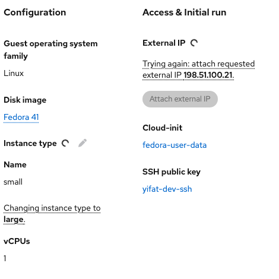
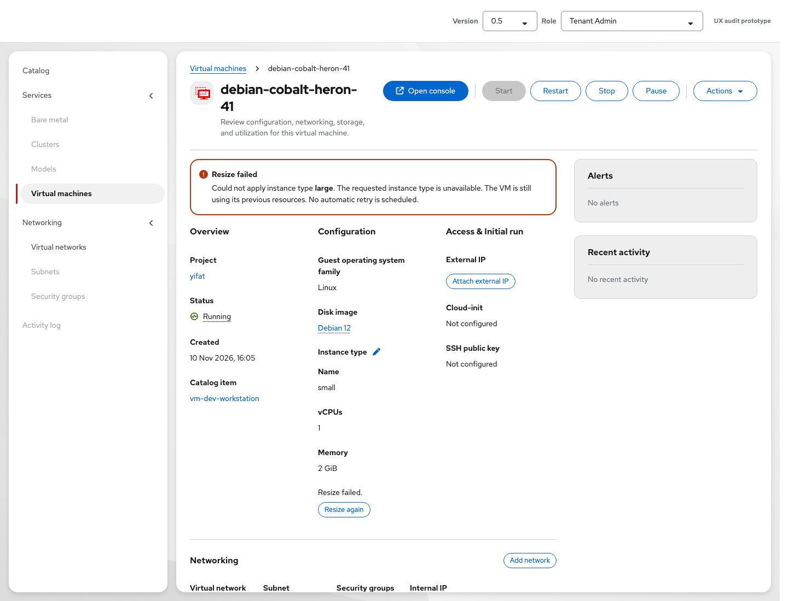
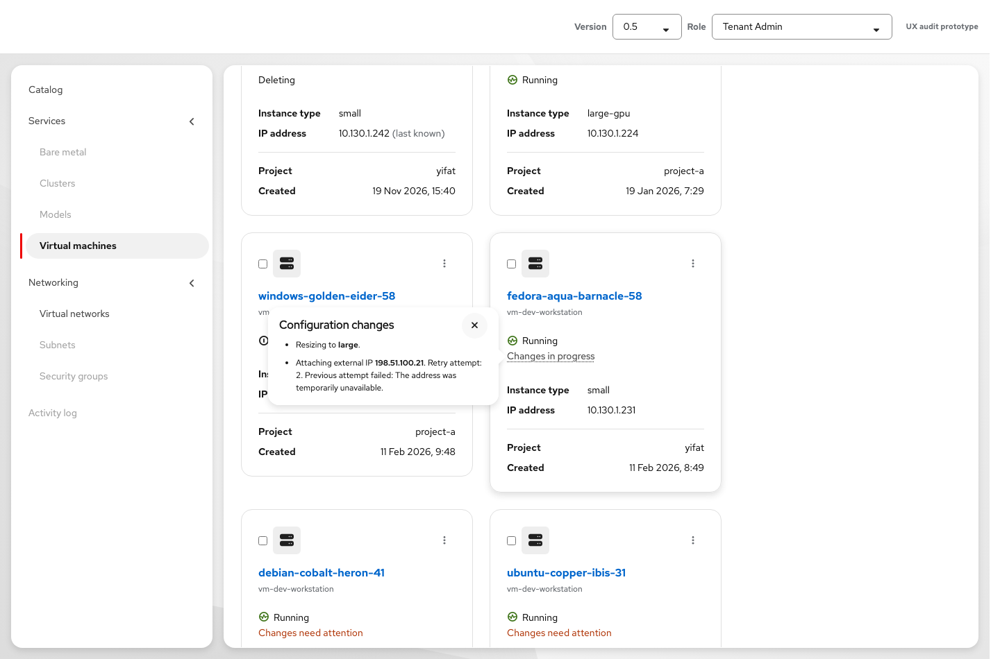
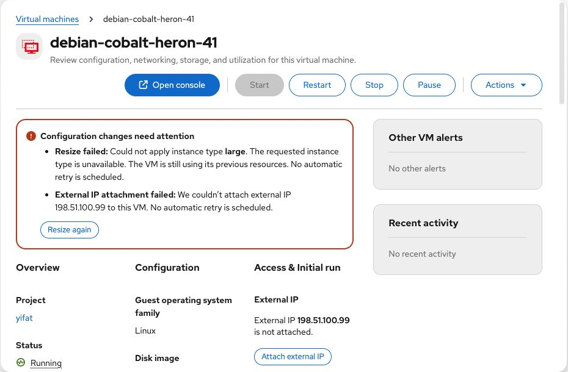
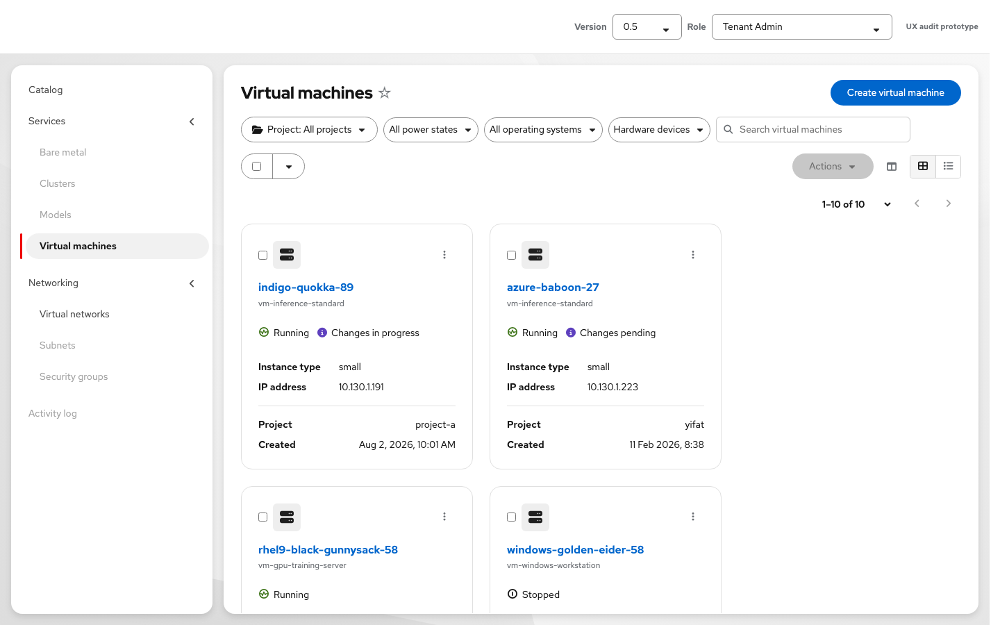
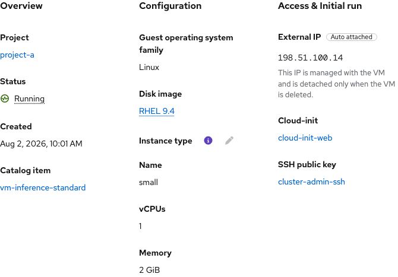

# VM Overview — UX handoff

Contact: Yifat Friman Menchik, UXD  
Google Doc: [VM Overview](https://docs.google.com/document/d/1Y8hjgE924owve0VXA3rkKqTYuB4sXKif8KhXyFL3hyQ/edit)  
OSAC-7158 Google Doc: [VM configuration operations](https://docs.google.com/document/d/1KkHVqjNJ4lZl40X8aE1v589jDd7ilAle9NnaV13DIr4/edit)
Interactive mocks: [0.4](https://osac-project.github.io/osac-ux/vmaas-ux-prototype-v0.4.html?v=c6c0274&role=admin&vm=indigo-quokka-89) · [0.5](https://osac-project.github.io/osac-ux/vmaas-ux-prototype.html?v=c15cd6a&role=admin&vm=indigo-quokka-89)

VM Overview shows the active instance type, CPU, and memory. Editing the instance type opens the name-first, two-line picker: each option has the resource name above CPU, memory, GPU count and readable model when present, and rate. Omit PCI hardware IDs from visible labels. The GPU specification still determines which resize targets are compatible. See the [resize handoff](osac-4281-vm-resize-handoff.md).

## Version 0.5 — configuration operations (OSAC-7158)

The Overview **Status** row shows the VM power state only. Keep active instance type, CPU, memory, and attached external IP as the main values. Keep the instance type name, CPU, memory, and GPU together. **Instance type** and **External IP** share one pattern: a spinner beside the heading only while an attempt runs, the current value, and a short, clickable status line naming the requested target. The status line opens a keyboard-accessible popover with the retry attempt and safe previous failure reason when available. The spinner itself is not interactive; no purple information icon is needed. Name an attached address **Current external IP** and an address being attached **requested external IP**. Keep Attach external IP visible but disabled while attachment runs or an automatic retry is scheduled. A scheduled retry has no spinner and no top danger alert. Use one top danger alert for final failures; when two operations fail, list both in one alert. Put the failure reason and **Resize again** action in that alert, without repeating the failure below Instance type. **Resize again** opens the resize dialog with the failed target selected for review; it never silently resubmits. Manual actions remain unavailable while an automatic retry is scheduled. After attachment finally fails, keep the attempted address out of the attached-IP value and offer **Attach external IP** to start another selection.

The [scheduled-retry example](https://osac-project.github.io/osac-ux/vmaas-ux-prototype.html?v=c15cd6a&role=admin&vm=rhel-retry-cedar-29) keeps both targets in context, disables competing actions, and omits spinners until the next attempt begins.

The [ubuntu-copper-ibis-31 example](https://osac-project.github.io/osac-ux/vmaas-ux-prototype.html?v=c15cd6a&role=admin&vm=ubuntu-copper-ibis-31) combines a failed resize with external-IP attachment still running. The top alert covers the resize failure and offers **Resize again**; IP progress and its disabled Attach button stay beside External IP. In lists and cards, **Changes need attention** takes precedence, while the popover names both operations.

### Simultaneous changes

Each operation keeps its own state on VM Overview: progress appears beside the Instance type or External IP heading, while the status line below opens details. Only final failures appear in the top alert. If several operations fail, use one alert with a bullet for each failure. Keep **Resize again** in the alert and offer the external-IP selection action beside External IP when available. Keep current values visible until each change succeeds.

The VM list and cards still show one configuration line below the power status. Choose its text by priority: **Changes need attention** if any operation has finally failed with no automatic retry planned; otherwise **Changes in progress** if any attempt is running; otherwise **Changes pending** if a retry is scheduled or a change waits for restart. A scheduled retry is pending, not in progress. Activating the line opens a keyboard-accessible popover with a separate bullet for each outstanding operation and target, so the summary does not hide concurrent work. If any operation has finally failed, add **Open VM details to try again.** below the list. Do not suggest another manual attempt while an automatic retry is scheduled or running. Remove each operation from the popover when it completes, and remove the configuration line when none remain.

If a retry is scheduled, say so in the popover and affected setting without showing a spinner. Once the retry runs, name its attempt when the service provides the count. If it supplies a safe reason for the preceding failure, show **Previous attempt failed: [reason]** there. If it reports a known prerequisite that blocks a change, explain the prerequisite in plain language in both places. Do not invent a blocker, reason, attempt count, or ETA when the service has not supplied one. Keep **Stopped** as a power state, not a configuration failure. After success, update the active value, remove the outstanding status, and show a brief success toast; do not retain a Completed line.

For example, [fedora-aqua-barnacle-58](https://osac-project.github.io/osac-ux/vmaas-ux-prototype.html?v=c15cd6a&role=admin&vm=fedora-aqua-barnacle-58) is resizing to **large** while attaching **198.51.100.21**. Its list status is **Changes in progress**, and the popover names both operations. In the [mixed failure example](https://osac-project.github.io/osac-ux/vmaas-ux-prototype.html?v=c15cd6a&role=admin&vm=ubuntu-copper-ibis-31), resize has failed while attachment continues, so **Changes need attention** takes priority.

The [two-failure example](https://osac-project.github.io/osac-ux/vmaas-ux-prototype.html?v=c15cd6a&role=admin&vm=debian-cobalt-heron-41) shows resize and external-IP failure as separate bullets in one alert. The IP remains unattached; **Resize again** opens the resize dialog with **large** selected for review.

When a resize requires a restart, show a **Restart required** warning above Overview. It is collapsed by default; expanding it explains the required action and shows the current and requested instance type, vCPUs, and memory. Keep the current resource values in Configuration without repeating the warning there. This actionable warning is the exception to failure-only top alerts. In VM lists and cards, show one text-only configuration status on a second line below the icon-and-text power status: subdued gray **Changes pending** or **Changes in progress**, or **Changes need attention** in the failure color. Do not add an icon to the configuration status. The popover names each relevant operation and target, including external-IP attachment. Remove it once no work is outstanding.

In card and table views, the VM list shows one configuration status below the power status. Activating it opens a popover that lists every outstanding operation and target.

For access, networking, storage, utilization, failure states, and permissions, follow the [Google UX handoff](https://docs.google.com/document/d/1Y8hjgE924owve0VXA3rkKqTYuB4sXKif8KhXyFL3hyQ/edit).

### Implementation data needed for OSAC-7158

The UI needs the operation type, phase (waiting for restart, retry scheduled, applying, finally failed, or complete), safe explanation, target value, and timestamps from the API or from documented derivation of its existing conditions. The UI must know whether another retry is planned before offering a manual action; an attempt count alone is insufficient. The list and Details must describe the same state after refresh or reconnect. API list/get and CLI table/json/yaml/describe need equivalent status semantics; the HTML mockup cannot verify those contracts. Never surface provider job IDs, raw logs, or raw error strings. Elapsed time is optional and should appear only when a reliable timestamp is available.

## Access and initial run examples

These 0.5 captures show the auto-attached, manually attached, inline Cloud-init, and Windows Sysprep states.

## Storage table typography

Networking and Additional disks column headings use the standard PatternFly 6 table heading typography in both versions: 14px semibold Red Hat Text in the regular text color. The same treatment applies to other custom table headers.

