# VM Overview — UX handoff

Contact: [Yifat Friman Menchik](mailto:yfrimanm@redhat.com), UXD
Google Doc: [VM Overview](https://docs.google.com/document/d/1Y8hjgE924owve0VXA3rkKqTYuB4sXKif8KhXyFL3hyQ/edit)  
OSAC-7158 Google Doc: [VM configuration operations](https://docs.google.com/document/d/1KkHVqjNJ4lZl40X8aE1v589jDd7ilAle9NnaV13DIr4/edit)
Interactive mocks: [0.4](https://osac-project.github.io/osac-ux/vmaas-ux-prototype-v0.4.html?v=c6c0274&role=admin&vm=indigo-quokka-89) · [0.5](https://osac-project.github.io/osac-ux/vmaas-ux-prototype.html?v=35578a8&role=admin&vm=indigo-quokka-89)

VM Overview shows the active instance type, CPU, and memory. Editing the instance type opens the name-first, two-line picker: each option has the resource name above CPU, memory, GPU count and readable model when present, and rate. Omit PCI hardware IDs from visible labels. The GPU specification still determines which resize targets are compatible. See the [resize handoff](osac-4281-vm-resize-handoff.md).

## Version 0.5 — configuration operations (OSAC-7158)

The Overview **Status** row shows VM power state only. Keep active instance type, CPU, memory, and **Current external IP** as the main values; show **Not attached** when there is no attached IP, including after an attachment failure. During an operation, put a spinner and an action-specific, link-styled popover button beside **Instance type** or **External IP**: **Resizing**, **Attaching**, or **Detaching**. The spinner is not interactive. The popover names the requested instance type, vCPUs, and memory, or the exact external IP; it shows retry attempt and previous failure reason only when supplied. Keep the current external IP visible until detachment succeeds. While an attachment is running, keep **Attach external IP** disabled and offer **Cancel attachment**. On confirmed cancellation, clear the pending target, keep **Current external IP: Not attached**, and re-enable Attach without showing a failure alert. A scheduled retry shows **Retry scheduled** without a spinner and disables competing actions. Final failures appear only in one top danger alert; if two operations fail, list both. Keep **Resize again** in that alert and offer **Attach external IP** for a final attachment failure. Do not show an attempted IP as attached or repeat failure text beside the setting.

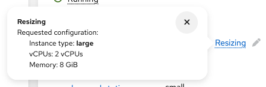

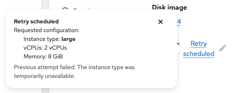

**Automatic external-IP retry.** The disabled Attach action prevents a competing request while the second attempt runs. Its heading popover names the target IP and previous failure. This seeded example remains in progress for review; use the [capture-mode VM](https://osac-project.github.io/osac-ux/vmaas-ux-prototype.html?v=be50d0f&role=admin&vm=rhel9-black-gunnysack-58&capture=1) to capture a successful attach and detach. Screenshot mode shows an on-page confirmation and holds each operation until **Finish demo step (screenshot mode)** is selected.

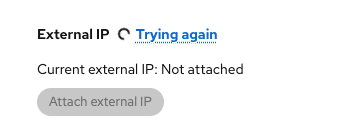

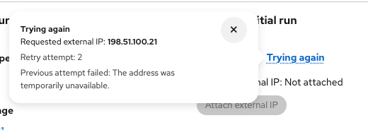

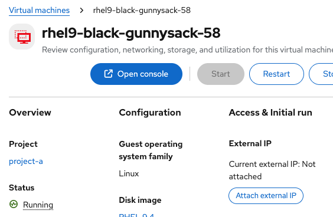

A refreshed Attaching screenshot showing **Cancel attachment** is pending.

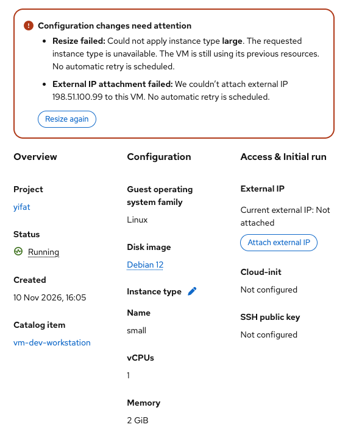

The [scheduled-retry example](https://osac-project.github.io/osac-ux/vmaas-ux-prototype.html?v=35578a8&role=admin&vm=rhel-retry-cedar-29) keeps both targets in context, disables competing actions, and omits spinners until the next attempt begins.

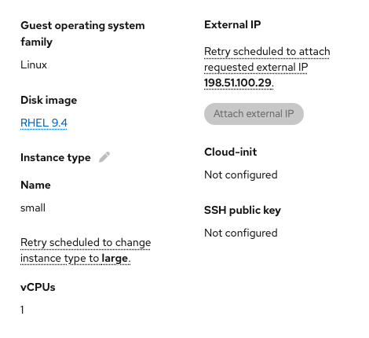

The [ubuntu-copper-ibis-31 example](https://osac-project.github.io/osac-ux/vmaas-ux-prototype.html?v=35578a8&role=admin&vm=ubuntu-copper-ibis-31) combines a failed resize with external-IP attachment still running. The top alert covers the resize failure and offers **Resize again**; IP progress and its disabled Attach button stay beside External IP. In lists and cards, **Changes need attention** takes precedence, while the popover names both operations.

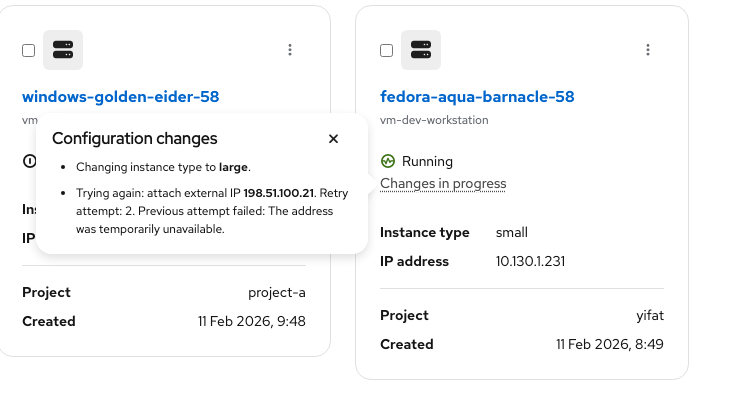

### Simultaneous changes

Returning from VM Details through the sidebar or breadcrumb refreshes both list and card values from the current VM state. Preserve the selected view, filter, page, and selection where valid. Close any stale configuration popover before rendering the list.

The sidebar card is **Other VM alerts**, with **No other alerts** when empty, so it does not contradict configuration failures shown above Overview. For a Tenant User without external-IP permissions, a final attachment failure says **Ask a tenant administrator to attach an external IP.** Show this guidance only when no automatic retry is scheduled or running. Tenant admins retain the **Attach external IP** recovery action.

Each operation keeps its own state on VM Overview. The heading control opens its details, while the current value stays below. Only final failures appear in the top alert. Keep **Resize again** in that alert and offer a new external-IP selection when available. Current values change only after success.

The VM list and cards still show one configuration line below the power status. Choose its text by priority: **Changes need attention** if any operation has finally failed with no automatic retry planned; otherwise **Changes in progress** if any attempt is running; otherwise **Changes pending** if a retry is scheduled or a change waits for restart. A scheduled retry is pending, not in progress. Activating the line opens a keyboard-accessible popover with a separate bullet for each outstanding operation and target, so the summary does not hide concurrent work. If any operation has finally failed, add an **Open VM details** button below the list. Do not suggest another manual attempt while an automatic retry is scheduled or running. Remove each operation from the popover when it completes, and remove the configuration line when none remain.

Use three plain-language states for each operation. **Retry scheduled: [target action]** means another attempt is planned; show no spinner and disable competing actions. **Trying again: [target action]** means that retry is running; show a spinner and keep manual actions disabled. A final failure with no planned retry appears in the top alert, where the user can start another attempt. On the first attempt, Details uses **Resizing**, **Attaching**, or **Detaching** beside the heading, while the list/card popover can say **Changing instance type** or **Attaching external IP** with its target. Add **Open VM details** to the list/card popover only after final failure. A failure reason or attempt count alone does not establish a retry plan.

When the service supplies a safe reason for the preceding failure, show **Previous attempt failed: [reason]** in the operation popover. Show a retry attempt number only while that retry runs and only when supplied. If the service reports a known prerequisite that blocks a change, explain it in plain language in both places. Do not invent a blocker, reason, attempt count, or ETA. Keep **Stopped** as a power state, not a configuration failure. After success, update the active value, remove the outstanding status, and show a brief success toast; do not retain a Completed line.

For example, [fedora-aqua-barnacle-58](https://osac-project.github.io/osac-ux/vmaas-ux-prototype.html?v=35578a8&role=admin&vm=fedora-aqua-barnacle-58) is resizing to **large** while attaching **198.51.100.21**. Its list status is **Changes in progress**, and the popover names both operations. In the [mixed failure example](https://osac-project.github.io/osac-ux/vmaas-ux-prototype.html?v=35578a8&role=admin&vm=ubuntu-copper-ibis-31), resize has failed while attachment continues, so **Changes need attention** takes priority.

The [two-failure example](https://osac-project.github.io/osac-ux/vmaas-ux-prototype.html?v=35578a8&role=admin&vm=debian-cobalt-heron-41) shows resize and external-IP failure as separate bullets in one alert. The IP remains unattached; **Resize again** opens the resize dialog with **large** selected for review.

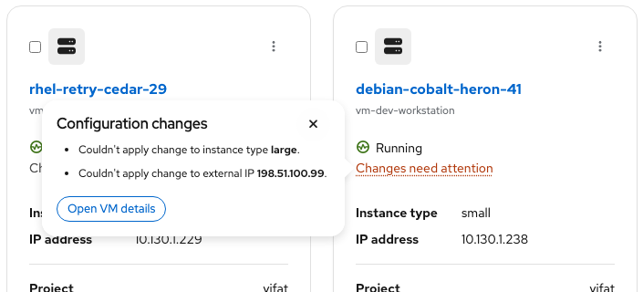

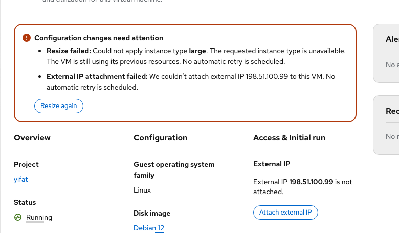

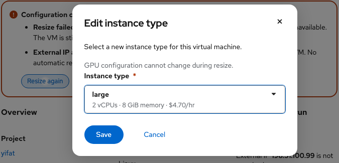

When a resize requires a restart, show a **Restart required** warning above Overview. It is collapsed by default; expanding it explains the required action and shows the current and requested instance type, vCPUs, and memory. Keep the current resource values in Configuration without repeating the warning there. This actionable warning is the exception to failure-only top alerts. In VM lists and cards, show one text-only configuration status on a second line below the icon-and-text power status: subdued gray **Changes pending** or **Changes in progress**, or **Changes need attention** in the failure color. Do not add an icon to the configuration status. The popover names each relevant operation and target, including external-IP attachment. Remove it once no work is outstanding.

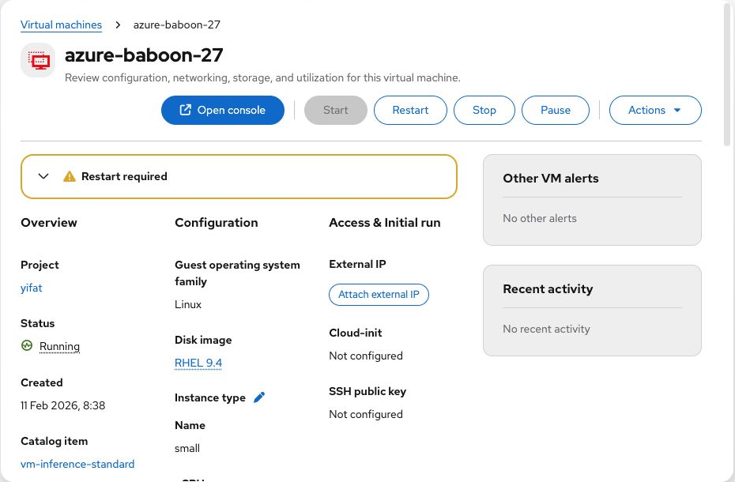

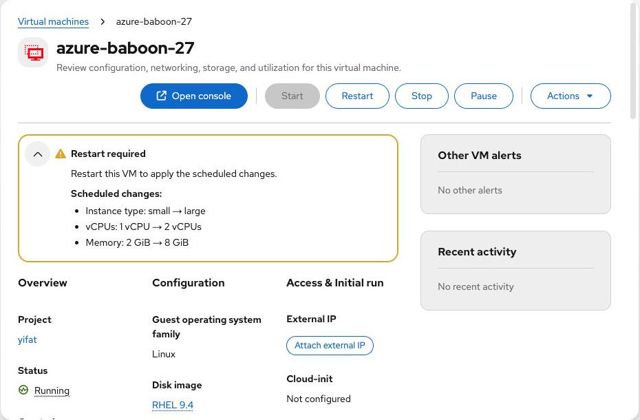

Selecting **Restart** from VM Details or a row action opens a confirmation naming the VM, warning that workloads and sessions will be interrupted, and listing the exact scheduled changes. Focus **Cancel** initially. Cancel, Close, or Escape dismisses the dialog without starting the restart or changing the saved configuration. Before proceeding, recheck permissions, the VM power state, and scheduled changes. If the changes differ, show the latest values for review and require another confirmation; if restart is unavailable, disable confirmation and explain why.

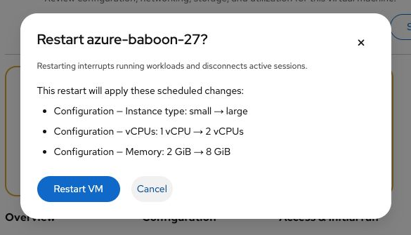

The resize and restart dialogs keep Tab and Shift+Tab inside the dialog and prevent background interaction. In the resize dialog, Escape closes an open instance-type picker first; a second Escape dismisses the dialog. On dismissal, return focus to the trigger or its current equivalent after a refresh; if that control becomes unavailable, focus the Configuration or VM heading.

**Proposed interaction; backend support unconfirmed.** If a saved resize can be replaced or canceled before restart, keep the Instance type pencil available. **Edit scheduled resize** shows **Using now** and **Scheduled after restart**, with **Cancel scheduled resize** beside the scheduled value. Choosing another type and selecting **Save** replaces the target; the separate cancel action removes the pending change and keeps the active type. The warning updates to the latest target and omits unchanged values. If the backend cannot support either action, keep the pencil disabled until the resize takes effect, with a tooltip explaining why. Confirm the backend operations before implementing the proposed actions.

During an active resize, disable the pencil and explain why on hover and keyboard focus. In the 0.5 mockup, `indigo-quokka-89` completes its demo resize after about 15 seconds; the pencil then becomes available. Apply the same explanatory tooltip pattern to every disabled icon control, including list actions and pagination.

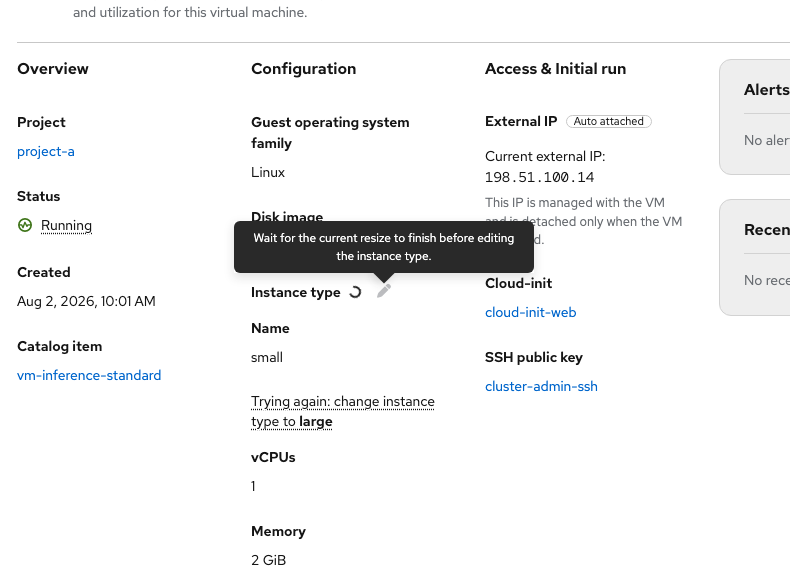

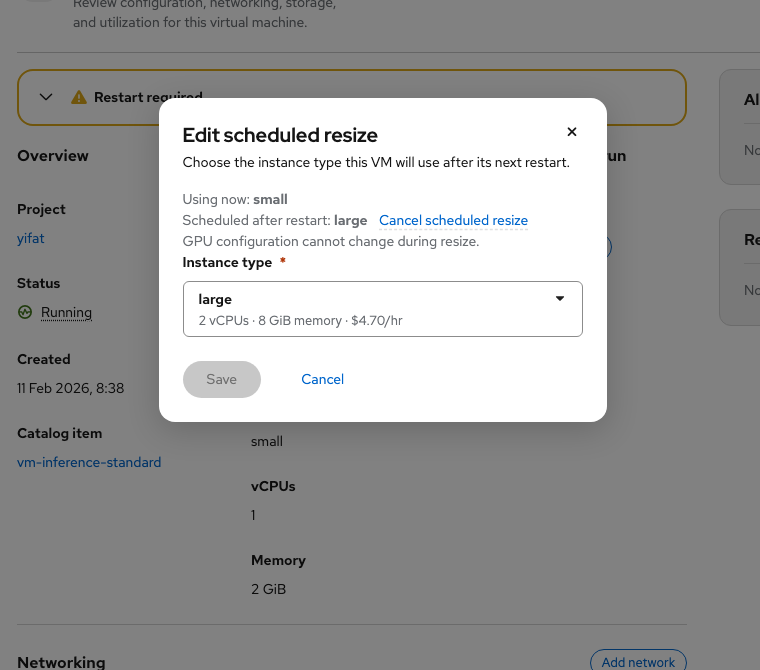

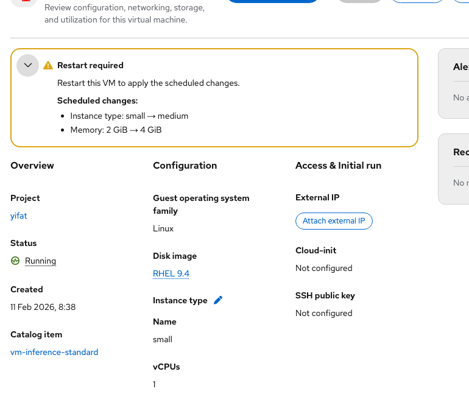

In card and table views, the VM list shows one configuration status below the power status. Activating it opens a popover that lists every outstanding operation and target.

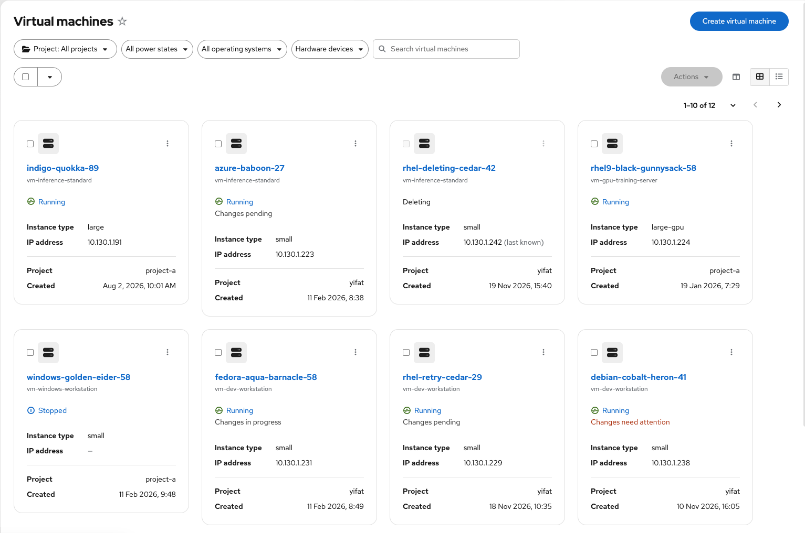

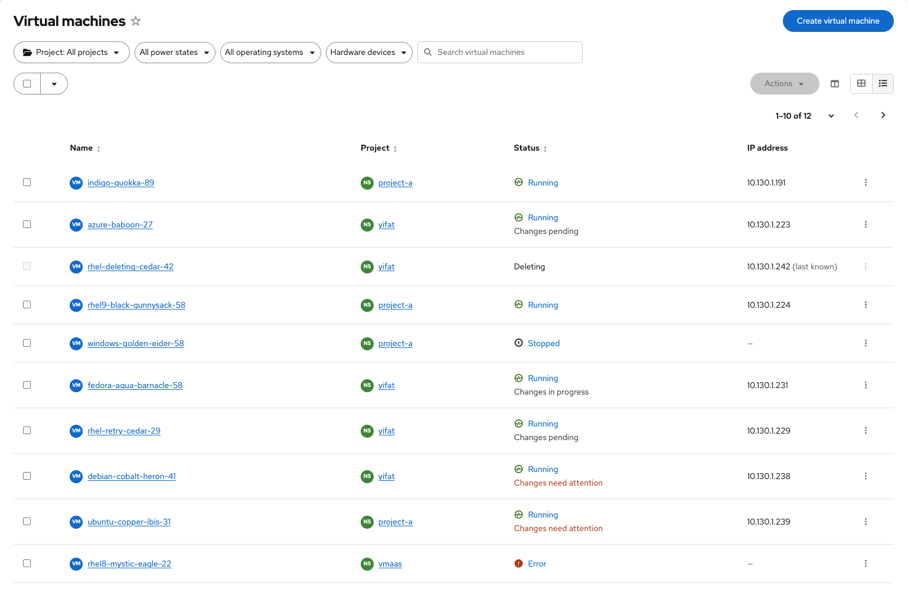

For access, networking, storage, utilization, failure states, and permissions, follow the [Google UX handoff](https://docs.google.com/document/d/1Y8hjgE924owve0VXA3rkKqTYuB4sXKif8KhXyFL3hyQ/edit).

### Implementation data needed for OSAC-7158

The UI needs the operation type, phase (waiting for restart, retry scheduled, applying, finally failed, or complete), safe explanation, target value, and timestamps from the API or from documented derivation of its existing conditions. The UI must know whether another retry is planned before offering a manual action; an attempt count alone is insufficient. The list and Details must describe the same state after refresh or reconnect. API list/get and CLI table/json/yaml/describe need equivalent status semantics; the HTML mockup cannot verify those contracts. Never surface provider job IDs, raw logs, or raw error strings. AAP-backed changes need at least the changed field name so the UI can name the operation. Full operation history is outside OSAC-7158.

**Still to validate against OSAC-7158:** The mockup does not demonstrate a prerequisite blocker or elapsed time in the VM list. Both require reliable service data, including timestamps that survive reconnects. Confirm which existing conditions expose these values and the retry phase; if the UI must derive a summary, document the derivation for API and CLI parity. Do not present an unsupported phase, blocker, or elapsed time as confirmed UX coverage. Confirm backend support before offering replacement or cancellation of a resize waiting for restart. Whether users can stop repeated automatic retries remains a separate product and backend decision; this handoff shows their status.

## Access and initial run examples

These 0.5 captures show Cloud-init and Windows Sysprep. The retry and failure captures above reflect the latest External IP design. Updated Attaching and Detaching screenshots are still pending after the new cancel action.

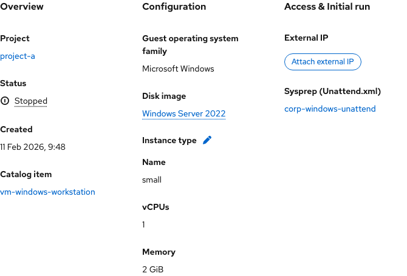

## Storage table typography

Networking and Additional disks column headings use the standard PatternFly 6 table heading typography in both versions: 14px semibold Red Hat Text in the regular text color. The same treatment applies to other custom table headers.

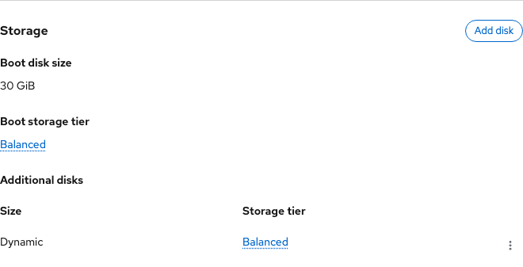

